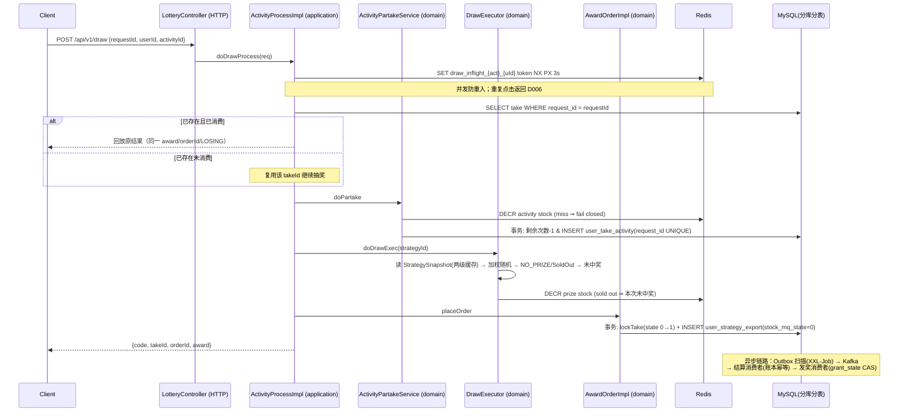

# Lottery — 高并发抽奖系统

这是一个用于学习与求职展示的 Java 后端高并发抽奖系统。项目重点不是堆砌技术栈，而是把复杂度集中在真正困难的问题上：**高并发库存竞争、重复请求、Redis/MySQL 最终一致性、Kafka 重复消费、发奖幂等与失败恢复**。

> 架构与失败语义的完整说明见 `docs/refactor-audit.md`（重构审计）、`docs/architecture.md`（架构决策与组件约束）、`docs/interview-architecture.md`（面试叙事）。

---

## 1. Project Overview

业务问题域：

| 问题 | 手段 |
| --- | --- |
| 高并发库存竞争 | Redis 原子预扣 + 启动预热，MySQL 条件更新最终兜底 |
| 重复抽奖请求 | `requestId` 业务幂等号 + DB 唯一约束兜底 + 属主可见的并发锁 |
| Kafka 重复消费 / 消费者 crash | `award_stock_settlement` 结算账本，`UNIQUE(order_id)` |
| 数据库库存结算慢操作 | Kafka 异步结算（Outbox 模式投递） |
| 发奖重试 | orderId 作为发奖幂等键 + `grant_state` CAS 标记 |
| 失败消息补偿 | Outbox 扫描任务 + invoice 补偿任务（XXL-Job 分片） |
| 用户数据量大 | 参与记录 / 中奖订单按 `uId` 分库分表（自研 dbRouterForGem） |
| 热点策略配置读取 | StrategySnapshot 两级缓存（Caffeine L1 + Redis L2） |

## 2. Draw Flow



异步链路：

```text
AwardOrder(本地事务写入 stock_mq_state=0)          ← Outbox 写入点
  → XXL-Job awardStockSettlementOutboxJobHandler 按 dbIdx 分片扫描 INIT/FAIL/超时 SENT
      → Kafka lottery_strategy_award_stock (key=orderId)
      → 发送回调条件更新：INIT/FAIL → SENT(3)，INIT → FAIL(2)；保护 COMPLETE/BLOCKED
  → StockSettlementListener
      → 本地事务: INSERT award_stock_settlement(UNIQUE order_id)
                  + UPDATE strategy_detail ... award_surplus_count > 0
      → duplicate key ⇒ 该订单早已结算，直接返回成功（绝不二次扣减）
      → 条件扣减失败 ⇒ BLOCKED(4)，持久化待对账事实后 ack；修复后显式释放原 Outbox
      → stock_mq_state=COMPLETE → 投递发奖消息
  → InvoiceListener → FulfillmentHandler.fulfill(orderId,...)（adapter stub）
      → grant_state CAS 标记完成，再将 mq_state 收口 COMPLETE 后 ack
```

后台任务统一由 XXL-Job 管理（多实例部署时按参数 `"1"` / `"1,2"` 分片指定各自负责的分库）：

```text
lotteryActivityStateJobHandler        活动时间校验 + 行锁内库存预热 → RUNNING(CAS) / 过期→CLOSED
awardStockSettlementOutboxJobHandler  库存结算 Outbox 扫描投递（分片参数）
lotteryOrderMQStateJobHandler         发奖消息补偿重发
```

## 3. Inventory Consistency

* **Redis**：实时库存控制（活动库存 + 各奖品库存）。`DECR` 后小于 0 会立即回补并判定售罄。
  * PASS 活动在开始时间到达后，由仓储在活动行锁内 `SETNX` 预热，再提交 DOING；Redis 失败保持 PASS，下轮可补齐（活动剩余库存 + 全部奖品剩余库存），预热值来自此刻可信的 MySQL。
  * **运行期间 key 丢失绝不回填 MySQL**——结算滞后使 MySQL 大于真实剩余量，回填会造成“库存复活”。处理方式是 fail closed：
    * 活动库存 miss → 直接拒绝本次抽奖（`D005 系统繁忙`），error 日志提示人工/对账恢复；
    * 奖品库存 miss → 该奖品视为不可售（error 日志），不影响其他奖品。
  * 不自动增加任何库存。
* **MySQL**：持久化库存与最终账本。活动配置为初始事实源；`strategy_detail.award_surplus_count > 0` 条件更新保证不超卖。
* **Settlement Ledger（`award_stock_settlement`）**：Kafka 消费幂等。`INSERT 账本 + 条件扣减`在同一本地事务（同库 db00）；`UNIQUE(order_id)` 使“同一 orderId 只可能扣一次数据库库存”。
* **Outbox**：创建订单与置待发送状态同事务；后续由调度扫描可靠投递。状态由 SQL 条件推进：发送成功 `INIT/FAIL → SENT`，账本成功后消费完成 `INIT/FAIL/SENT/BLOCKED → COMPLETE`，迟到发送回调不能覆盖 COMPLETE/BLOCKED；库存 SENT 超时 10 分钟可重投，详见[消息状态修复说明](docs/kafka-mq-state-cas.md)。

## 4. Failure Cases

| 场景 | 行为 |
| --- | --- |
| Redis 库存 key missing（运行中） | fail closed：活动库存报 `D005`，奖品视为不可售；日志 error 提示人工对账恢复，禁止运行期自动预热 |
| 并发重复点击 | inflight 锁 NX PX，值=随机 token；仅属主可释放（Lua compare-and-delete） |
| 同 requestId 重试（超时/网关重试） | 按 `request_id` 命中已有 take：已消费 → 回放原中奖/未中奖结果；未消费 → 复用继续抽奖。DB `UNIQUE(request_id)` 兜底，不重复消耗次数 |
| Kafka 重复投递（库存消息） | settlement 账本 duplicate-key → 幂等短路 |
| 结算消费者 crash（扣减后、状态更新前） | 未 ack 触发 redelivery；账本保证重放只扣一次 |
| Kafka send 失败 | 状态落 FAIL(2)，下一轮 XXL-Job 扫描重投 |
| 库存条件扣减分歧 | 账本回滚，订单 BLOCKED(4) 等待对账；持久化失败不 ack，修复后 CAS 4→0 恢复 |
| 启动预热失败 | 行锁内先预热后 CAS；Redis 异常传播，活动保持 PASS，SETNX 补齐不覆盖旧值 |
| 发奖消费者 crash / 重复消费 | `grant_state <> 1` 的 CAS 更新幂等；已完成则直接 ack |
| 下单 DuplicateKeyException | 回滚 + Redis 奖品库存回补（INCR），客户端按需重试 |

## 5. Known Limitations（不隐藏）

* **dbRouterForGem 不支持通用复杂 SQL**：MyBatis 插件用正则替换第一处表名后缀，JOIN/子查询里出现的其它分表不会被替换；路由算法 `(size-1)&hash` 隐含 `dbCount*tbCount` 必须是 2 的幂（当前 2×4=8）。详见 `docs/architecture.md` 第 6 节。
* **开发环境 Kafka 可能为单副本**（replicas=1），不具备生产级可靠性；acks=1。
* **未宣称生产 QPS**：仓库内仅提供 jmeter 脚本骨架（`doc/jmeter/`），没有任何未经复现的性能数字。
* **发奖渠道为 adapter stub**：Coupon/RedeemCode/Physical 等 handler 目前只是模拟调用并落库，未对接真实第三方系统；接入时以 `orderId` 为 idempotencyKey。
* **Redis 库存恢复策略仍有生产化空间**：PASS 启动失败可重试；运行期 Key 丢失须人工对账，禁止以滞后 MySQL 直接回填；跨实例缓存一致性依靠短 TTL 最终一致，不做广播失效。
* 多实例部署时 Snowflake workerId 由 IP 派生，极端场景需要改为配置分配。

## 6. Project Layout

```text
lottery-interfaces       HTTP adapter（LotteryController）+ SpringBoot 启动 + MyBatis mapper XML + 测试
lottery-application      use case 编排：draw 流程、Kafka producer/consumer、XXL-Job 任务
lottery-domain           业务规则：参与资格、策略快照与加权随机、中奖订单、活动生命周期、发奖抽象
lottery-infrastructure   MyBatis DAO/PO、Repository 实现、Redis 工具与锁 Guard、缓存实现、分库分表路由细节
lottery-common           Result / Constants（枚举 + RedisKey）
```

中间件存在的理由一句话总结：

```text
Redis     —— 库存原子性与并发控制，不是事实来源
Kafka     —— 把结算/发奖从同步链路剥离并提供重试语义
Outbox    —— 解决 "DB 成功但消息永远没发出去"
Ledger    —— 解决 "消息可能被消费多次" 
XXL-Job   —— 集中可靠的调度与补偿，替代每实例 @Scheduled
Caffeine  —— StrategySnapshot 高频读低变更
分库分表  —— 用户维度参与/订单数据线性增长的路由问题
```

## 7. Build & Test

```bash
# 编译 + 单元测试门禁（无需外部环境）
mvn clean test

# 需要本机 MySQL/Redis/Kafka 的集成测试（ManualIT 命名规范，默认被 surefire 排除）
mvn test -Dtest='*ManualIT'
```

测试运行说明与手工环境要求见 `docs/architecture.md`。SQL 初始化使用 `doc/sql/`（基线）+ `docs/sql/V2__architecture_simplification.sql`（本次重构迁移，幂等列/账本/索引）。

抽奖请求号、未完成参与恢复与发布前迁移见 [抽奖幂等接口说明](docs/draw-request-idempotency.md)。

最新的四项正确性修复、真实 HTTP 业务 E2E、执行命令和简历证据边界见[最终验证报告](docs/final-correctness-e2e.md)。
