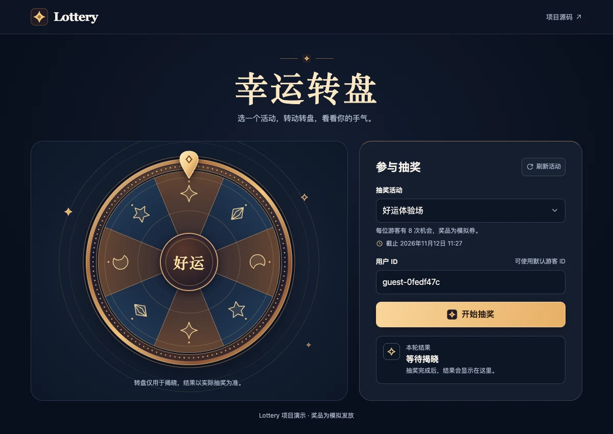
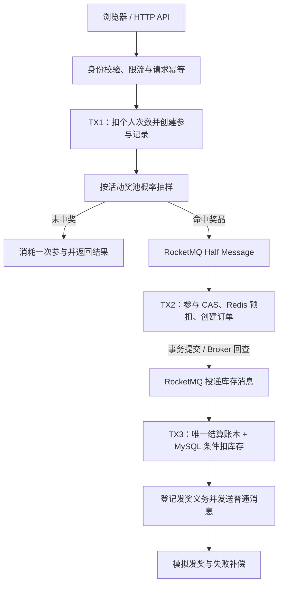

# Lottery

> **一个可运行、可验证的高并发营销抽奖系统。**

Lottery 基于 **Java / Spring Boot** 实现活动奖池、概率抽奖、中奖订单和异步发奖的完整业务链路。它重点解决高并发下常见的 **重复请求、库存竞争、消息重投与故障恢复** 问题，并提供真实中间件测试和性能实验，方便理解与复现相关工程方案。

这是一个**后端工程实践与参考实现**，并非已投入生产的商业抽奖平台。当前发奖渠道使用本地模拟适配器。

**Java 8 · Spring Boot 2.3.5 · MyBatis · MySQL · Redis · Caffeine · RocketMQ · Maven · JMeter**

[体验演示](#体验演示) · [快速开始](#快速开始) · [系统架构](#系统架构) · [性能与验证](#性能与验证) · [技术文档](#技术文档)

## 体验演示

项目提供一个与后端一起发布的幸运转盘页面，无需单独构建前端。选择活动和测试账户后，可以抽奖、查看剩余次数及中奖结果。



这不是单纯的转盘动画：**抽奖结果由真实后端业务流程决定**，前端只负责展示；中奖订单在后台完成库存结算和模拟发奖。请求结果未知时，页面支持使用原请求号恢复抽奖。

[查看完整的本地演示操作](docs/web-demo.md)

## 核心能力

| 能力 | 具体做什么 |
| --- | --- |
| **活动与奖池** | 配置活动时间、个人参与次数、独立奖品库存与中奖概率 |
| **概率抽奖** | 基于整数权重进行随机抽样，支持不中奖结果；售罄不重分配其他奖品概率 |
| **高并发库存** | Redis Lua 原子预扣；MySQL 库存结算支持单行及 8 桶模式，降低热点行竞争 |
| **请求幂等** | 通过 `requestId`、参与记录和数据库唯一约束实现重试回放与未完成请求恢复 |
| **可靠异步处理** | RocketMQ 事务消息衔接订单提交与库存结算，消费者以唯一账本和状态 CAS 去重 |
| **失败补偿** | 对消息重复、进程退出、结算失败和发奖义务未完成等场景进行核对或恢复 |

系统还使用 **Caffeine + Redis** 缓存热点奖池快照，并在 HTTP 入口结合本机并发保护与 Redis 限流控制流量。

## 快速开始

### 环境要求

- 项目按 **Java 8** 目标构建，使用 **Maven 3.x**。
- 本地完整演示脚本需要 **JDK 17、Python 3、Docker Compose**。
- 依赖 **MySQL 8.0、Redis、RocketMQ 5.3.4**；演示环境由仓库脚本启动独立容器。

### 1. 构建与基础测试

```bash
git clone https://github.com/kaguranananana/lottery.git
cd lottery

mvn clean test
mvn clean package
```

### 2. 准备一套独立演示环境

以下步骤面向**全新测试环境**；会启动容器并初始化专用数据库，请勿对已有业务库执行初始化。

```bash
python3 doc/performance/environment.py up
bash lottery-interfaces/src/test/resources/mq-e2e/create-topics.sh lottery-rocketmq-perf-broker-1 20911
python3 doc/performance/environment.py init
bash doc/performance/build.sh
bash doc/performance/start.sh /tmp/lottery-web-demo --lottery.draw.local-demo-enabled=true
```

保持应用运行。在另一个终端创建演示活动：

```bash
curl --fail-with-body http://127.0.0.1:18190/__perf/setup \
  --data 'id=720101&stock=30&quota=2&users=0&prefix=demo-&awardRate=0.14' \
  --data-urlencode 'name=好运体验场'
```

现在打开 **http://127.0.0.1:18190/**，使用 `demo-a` 抽奖，再切换 `demo-b` 查看独立的参与次数。演示活动有有效期，已有数据环境应更换未使用的活动 ID。

结束时在应用终端按 `Ctrl+C`，并运行 `python3 doc/performance/environment.py stop` 清理演示容器。

> 这条快速体验路径复用仓库的**专用压测环境脚本**，其中 `/__perf/setup` 是仅供隔离测试的辅助接口，不应作为生产管理 API。已有 MySQL / Redis / RocketMQ 环境的启动方式见[本地演示指南](docs/web-demo.md)。

## 系统架构

项目采用**单体部署、Maven 多模块分层**：`interfaces` 负责 HTTP，`application` 编排用例与消息，`domain` 承载业务规则，`infrastructure` 实现数据库、缓存与中间件适配。

一次抽奖的主要链路：



几个关键设计取舍：

- **Redis 负责并发准入，不负责最终事实**：Lua 原子预扣库存；持久化订单、库存结算及去重事实由 MySQL 事务和唯一约束负责。
- **事务消息连接两个提交边界**：TX2 创建订单后通过 RocketMQ Commit / 回查决定是否投递；TX3 对库存执行幂等结算。
- **失败可以追踪并恢复**：重复消费不会重复扣库存；库存差异可进入 `BLOCKED`，超时订单和发奖义务由定时核对兜底，但部分异常仍需人工对账。
- **不为了并发而过度拆分**：业务表位于单个 MySQL 数据库；新建奖品默认使用 8 个库存桶分散行锁竞争，同时保留旧单行模式兼容。

详细的状态流转、事务时序与组件选择见[系统设计](docs/architecture.md)、[RocketMQ 事务协议](docs/rocketmq-transactional-report.md)和[库存分桶方案](docs/stock-bucket-closure-evidence-20261115.md)。

## 性能与验证

项目不仅检查 HTTP 是否成功，还核对参与次数、订单、库存、结算账本、发奖状态及消息积压。**以下数据来自不同阶段的本地实验，不能直接合并为当前版本的最大吞吐或生产 SLA。**

| 实验 | 实测结果 | 适用范围 |
| --- | --- | --- |
| RocketMQ 事务版持续负载 | **150 RPS × 300 秒**，实际约 149.83 次抽奖/秒；HTTP P95/P99 为 338/538 ms | 2026-11-14 实验环境，单 Broker、模拟发奖；对应版本的全链路审计通过 |
| 8 桶与单行库存对照 | 两轮交错对照中 MySQL 行锁等待次数分别下降 **86.61% / 86.07%** | 2026-11-15 的 300 RPS 定向实验；部分场次出现消息积压，**不代表长期稳定 300 RPS** |
| 补偿查询索引优化 | 约 43 万历史订单的空扫描行数 **430,953 → 0**，Handler 平均耗时 **248.87 → 6.15 ms** | 早期专项 SQL 对照；不等于整体吞吐提升相同比例 |

报告及复现步骤：

- [RocketMQ 事务与故障验证报告](docs/rocketmq-transactional-report.md)：含消息回查、重启恢复、四档 JMeter 负载和测试条件。
- [库存分桶对照实验](docs/stock-bucket-closure-evidence-20261115.md)：含行锁证据、失败场次和结论边界。
- [性能测试与复现](doc/performance/README.md)：含测试环境、脚本、指标采集和历史 Kafka 实验。
- [SQL 优化报告](doc/performance/optimization-report.md)：含具体查询与执行计划对照。

历史 **Kafka / Outbox** 架构数据作为独立实验保留，不应被理解为当前 **RocketMQ** 实现的直接性能指标。

### 测试

```bash
# 不需要启动外部中间件的默认单元测试
mvn clean test

# 在隔离环境执行当前库存流程回归（需要 Docker）
bash lottery-interfaces/src/test/resources/mq-e2e/verify.sh
```

部分 `*ManualIT` 用例会修改测试数据库或停启 Broker，只能在专用隔离环境运行。测试范围与操作约束见[质量指南](.trellis/spec/backend/quality-guidelines.md)。

## 技术文档

| 主题 | 文档 |
| --- | --- |
| 本地演示与测试账户 | [幸运转盘演示指南](docs/web-demo.md) |
| 整体模块与业务链路 | [系统架构](docs/architecture.md) |
| 事务消息、结算与故障回查 | [RocketMQ 事务协议](docs/rocketmq-transactional-report.md) |
| 幂等键与重复请求恢复 | [请求幂等设计](docs/draw-request-idempotency.md) |
| 库存分桶、验证与回退 | [分桶实验](docs/stock-bucket-closure-evidence-20261115.md) · [运维说明](docs/stock-bucket-rollout-20261115.md) |
| 新库初始化 | [完整 SQL Schema](docs/sql/lottery-schema.sql) · [演示种子数据](docs/sql/lottery-demo-seed.sql) |
| 测试与历史优化数据 | [压测与复现](doc/performance/README.md) |

## 当前边界

- **模拟发奖**：尚未对接真实优惠券、物流或第三方渠道；外部渠道还需要独立设计幂等和查单能力。
- **部署范围**：本地单 Broker 测试不等于生产高可用；跨实例、跨机房和容灾能力没有据此得到证明。
- **库存异常**：运行中 Redis 库存 Key 丢失需要对账恢复；当前不是完全自动化的跨存储灾备系统。
- **开源授权**：仓库当前没有根目录 `LICENSE` 文件。代码公开可见不等于已自动授予复用、修改或再分发许可；正式开放贡献前应明确许可证。
