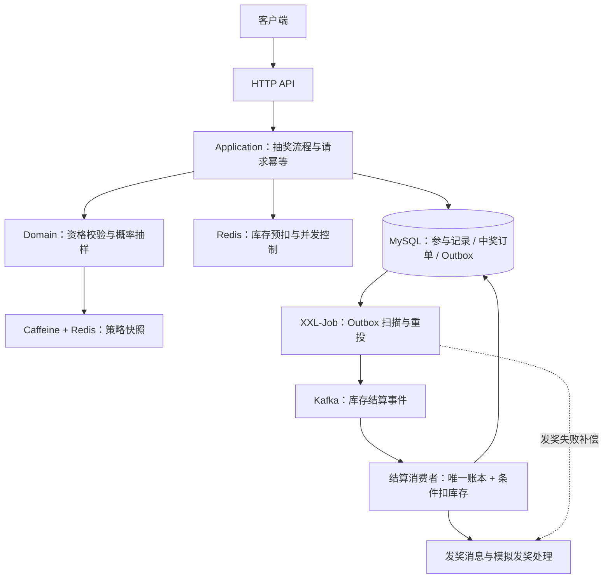

# Lottery · 高并发抽奖与异步发奖系统

> 基于 Java / Spring Boot 的电商营销抽奖系统，围绕高并发库存控制、请求幂等、异步结算及故障恢复展开工程实践。


**Lottery 是一个以学习和技术实践为目的的 Java 后端项目，并非实际生产部署的商业系统。** 项目模拟营销抽奖业务，涵盖活动配置、参与资格校验、概率抽奖、中奖订单和异步发奖，重点研究系统在重复请求、库存竞争、消息重投及部分组件故障下如何维持业务正确性。

技术栈：**Spring Boot · MyBatis · MySQL · Redis · Caffeine · Kafka · XXL-Job · Maven · JMeter**

## 核心特性

| 主题 | 设计与实现 |
| --- | --- |
| 并发库存 | Redis 原子预扣控制活动与奖品库存，MySQL 条件更新作为持久化结算约束 |
| 请求幂等 | `requestId` 标识一次逻辑抽奖，配合数据库唯一约束、未完成参与恢复和结果回放 |
| 可靠异步结算 | 中奖订单和待投递状态在同一事务写入，通过 Transactional Outbox + Kafka 异步结算 |
| 消费幂等与补偿 | `UNIQUE(order_id)` 结算账本、状态 CAS 和 XXL-Job 扫描处理重复消费与失败恢复 |
| 缓存与数据组织 | Caffeine + Redis 两级策略缓存；参与记录和订单按用户维度路由至分库分表 |
| 验证与性能 | 单元测试、真实中间件 E2E、JMeter 压测及 SQL 执行计划对照实验 |

## 系统架构

项目以 **单体部署、Maven 多模块分层** 为基础，分离 HTTP 接口、用例编排、业务规则和基础设施实现。



一次抽奖的主要过程如下：

1. HTTP 接口接收 `userId`、`activityId` 和 `requestId`，进入应用层编排。
2. 通过短时并发锁、请求号及参与记录，判断是新请求、结果回放还是未完成请求恢复。
3. 校验活动和剩余参与次数，在 Redis 预扣活动库存，并在 MySQL 事务中记录参与事实。
4. 读取策略快照进行加权随机抽样；中奖时预扣奖品 Redis 库存。
5. 创建中奖订单，并将待结算状态作为 Outbox 义务持久化。
6. XXL-Job 扫描 Outbox，将结算事件发送到 Kafka；消费者用唯一账本与条件更新完成 MySQL 库存结算，随后推进模拟发奖。

## 关键技术设计

### 1. 库存一致性：Redis 预扣与 MySQL 结算

- **Redis** 承担高并发下的活动库存与奖品库存原子预扣，避免大量请求直接竞争数据库库存行。
- **MySQL** 保留持久化记录，奖品库存采用 `surplus > 0` 条件更新，阻止并发结算导致负库存。
- 活动开始前由调度任务预热库存，活动状态通过数据库行锁和条件更新推进。
- 对运行中丢失的 Redis 库存 Key 采用 **fail closed**：拒绝本次活动抽奖或将对应奖品视为不可售，不使用可能滞后的 MySQL 库存直接回填，避免“库存复活”。

Redis 预扣与数据库异步结算并非跨存储原子事务，因此系统还需要结算账本、状态管理和故障补偿来处理不一致窗口。

### 2. 请求幂等：同一次抽奖只消耗一次机会

短时 Redis 锁负责抑制并发重复进入，**持久化幂等** 则依靠请求号与数据库约束，而非依赖锁的有效期。

- 客户端为每次新的逻辑抽奖生成独立 `requestId`。
- 网络超时后复用原请求号，已完成请求回放原中奖或未中奖结果。
- 参与已登记但尚未消费时，恢复原参与记录，不额外扣减参与次数。
- 数据库唯一约束兜底并发竞争；锁采用随机 token 和 compare-and-delete 防止误删他人的锁。

相关设计见 [抽奖请求幂等说明](docs/draw-request-idempotency.md)。

### 3. Transactional Outbox + Kafka：异步结算与可恢复投递

抽奖下单与“待发送库存结算消息”状态写入同一数据库事务，避免订单已提交但消息义务丢失。XXL-Job 按分片扫描待处理或超时消息并重新投递。

Kafka 按 `orderId` 发送结算事件，消费端将两项操作放在同一个 MySQL 本地事务中：

1. 插入 `award_stock_settlement` 结算账本，`order_id` 唯一。
2. 对奖品库存执行带剩余量条件的扣减。

即使 Kafka 重复投递，已存在的订单账本也能阻止同一订单重复扣库存。消息状态通过 SQL 条件更新（CAS）推进，避免迟到的发送回调覆盖已完成状态。

发送失败可以重试；数据库库存分歧则进入 **BLOCKED** 待对账状态，防止对不可自动修复的业务异常无限重投。

### 4. 概率抽奖与热点缓存

- 使用 `BigDecimal` 将奖品概率转换为整数权重，通过随机整数、前缀和与二分查找完成抽样。
- 配置概率总和不足 100% 时，剩余概率归入 `NO_PRIZE`；命中已售罄奖品不会重新分配其他奖品的概率。
- 对高频读取、低频变更的策略快照使用 **Caffeine L1 + Redis L2** 两级缓存，接受短 TTL 内的配置最终一致性。

### 5. 用户维度分库分表

用户参与记录、参与次数与中奖订单按 `uId` 路由到两个用户库；订单在每个用户库进一步拆分为四张表，共 **2 库 × 4 张订单表**。请求幂等与参与次数约束在用户所属分片内完成。

路由组件用于实践 Hash 路由和 MyBatis 表名改写，不支持通用跨分片 JOIN 或聚合查询，具体限制见 [架构说明](docs/architecture.md)。

## 性能测试与优化

项目使用 JMeter 和独立 Docker 中间件环境测试 **HTTP → Redis → MySQL 分片事务 → Outbox → Kafka → 库存账本 → 本地模拟发奖** 的真实链路，并针对 SQL 扫描和 JDBC 往返做定向分析。

### 补偿任务查询优化

对约 **43.1 万条历史订单** 的发奖补偿空扫描进行索引实验，使用相同数据、执行计划及索引可见性正反向对照核验结果。

| 指标 | 优化前 | 优化后 |
| --- | ---: | ---: |
| 补偿空扫描检查行数 | 430,953 | 0 |
| Handler 平均耗时 | 248.87 ms | 6.15 ms |

该数据表示**特定补偿扫描路径**的优化效果，不等于系统整体吞吐提升相同比例。

### 完整链路持续负载

在本地单应用、单 Kafka Broker、模拟发奖条件下：

- **150 RPS** 完成两次连续 **300 秒** 的完整异步链路验收，满足预设 HTTP、积压增长、异步完成和最终业务审计条件。
- 更高的 **180 / 200 RPS** 长时间测试未全部满足稳定性条件；150 RPS 的早期一次测试也未通过，因此不能据此认定最大稳定容量。
- 曾测得 **328.9 RPS** 的短时 HTTP 入口吞吐，但该轮产生明显异步积压，**不作为稳定全链路吞吐**。

相关证据与复现方法：

- [性能压测与优化报告](doc/performance/optimization-report.md)
- [性能测试环境与运行步骤](doc/performance/README.md)
- [JDBC 与持续负载验证记录](doc/performance/results/20261013-jdbc-session/README.md)
- [稳定性验收标准](doc/performance/stability.md)

## 构建与运行

### 环境依赖

- Java 8、Maven 3.x（项目使用 Spring Boot 2.3.5.RELEASE）
- MySQL、Redis、Kafka / ZooKeeper
- XXL-Job（活动状态调度、Outbox 投递及发奖补偿）
- `cn.bugstack.middleware:db-router-spring-boot-starter:1.0.4` 路由依赖，需确保本地 Maven 仓库能够解析

### 本地构建

```bash
git clone https://github.com/kaguranananana/lottery.git
cd lottery

# 默认单元测试（不需要启动外部中间件）
mvn clean test

# 构建 Spring Boot WAR
mvn clean package
```

构建产物为 `lottery-interfaces/target/Lottery.war`。若 Maven 提示无法解析数据库路由依赖，需要先准备相应组件的本地 Maven 制品。

### 数据初始化与应用启动

1. 准备独立的 MySQL 测试实例，创建 `lottery`、`lottery_01` 和 `lottery_02` 三个数据库。
2. 参考 `doc/sql/` 中的基线结构、库存 Outbox 和补偿索引脚本，以及 `docs/sql/V2__architecture_simplification.sql`、`docs/sql/V3__draw_request_ownership.sql` 完成建表及迁移。**部分基线脚本包含 `DROP TABLE` 和历史测试数据，只能在独立测试库操作；V2 包含需要按物理表处理的说明性 SQL，不能将其当作一键完整迁移。**
3. 根据本地环境配置 `lottery-interfaces/src/main/resources/application.yml`，包括 MySQL、Redis、Kafka 和 XXL-Job 地址及凭据；默认配置的 MySQL 端口为 `13306`、Redis 为 `6379`、Kafka 为 `9092`。
4. 启动所需中间件与应用；活动应按正常状态流转完成库存预热，不能仅将数据库状态改为运行中来跳过预热。

```bash
java -jar lottery-interfaces/target/Lottery.war
```

可通过 HTTP 接口访问当前运行中的活动与提交抽奖请求：

```bash
curl http://localhost:8080/api/v1/activities

curl -X POST http://localhost:8080/api/v1/draw \
  -H 'Content-Type: application/json' \
  -d '{"userId":"u1","activityId":100001,"requestId":"example-draw-001"}'
```

示例 `activityId` 和 `userId` 须替换为当前测试库中已配置并满足参与条件的数据；同一次抽奖重试应保留原 `requestId`。仓库的性能测试环境、数据准备及完整复现步骤另见 [性能测试指南](doc/performance/README.md)。

## 测试与验证

仓库提供概率抽样、请求幂等、并发锁、状态推进和消息回调等单元测试，以及使用真实 MySQL、Redis、Kafka 的集成与 E2E 测试。

- 默认单元测试通过 Maven `mvn clean test` 执行。
- `*ManualIT` 集成测试需要专用中间件、数据库初始化和测试配置；部分场景会修改专用测试库或停启 Broker，**不要直接对现有业务环境批量运行**。
- 完整 E2E 覆盖真实 HTTP 请求、两库八张订单分表、库存结算、消息重复投递、故障恢复和本地模拟发奖。

测试环境、覆盖范围与验证边界见 [正确性与 E2E 验证](docs/final-correctness-e2e.md)。

## 项目结构

```text
lottery-interfaces        Spring Boot 启动入口、HTTP API、测试
lottery-application       抽奖流程编排、Kafka 生产/消费、XXL-Job 任务
lottery-domain            资格校验、策略抽样、活动与订单业务规则
lottery-infrastructure    MyBatis / Redis / Repository / 缓存与路由实现
lottery-common            统一结果、枚举与公共常量

doc/sql                   数据库基线及索引脚本
doc/performance           压测工具、报告与验证证据
docs                      架构、幂等、一致性与 E2E 设计文档
```

## 实现边界

本项目主要用于学习后端系统在并发、异步和故障场景下的工程设计，当前仍有以下边界：

- 发奖处理为 **本地模拟适配器**，未接入真实优惠券、物流或第三方发奖平台。
- Kafka 测试环境采用单 Broker / 单副本，不代表生产级高可用或跨机房容灾。
- Redis 运行期库存 Key 丢失需要独立对账恢复，尚无自动化跨存储对账流程。
- 用户分片路由面向当前单表访问模式，不提供通用分布式 SQL 能力。
- 压测数字仅对应所记录的本地环境、数据量及测试方法，不代表生产 SLA 或确定的最大吞吐上限。

## 延伸阅读

- [架构设计与组件取舍](docs/architecture.md)
- [抽奖请求幂等](docs/draw-request-idempotency.md)
- [Kafka 消息状态与 CAS](docs/kafka-mq-state-cas.md)
- [正确性与 E2E 验证](docs/final-correctness-e2e.md)
- [性能测试与优化报告](doc/performance/optimization-report.md)
