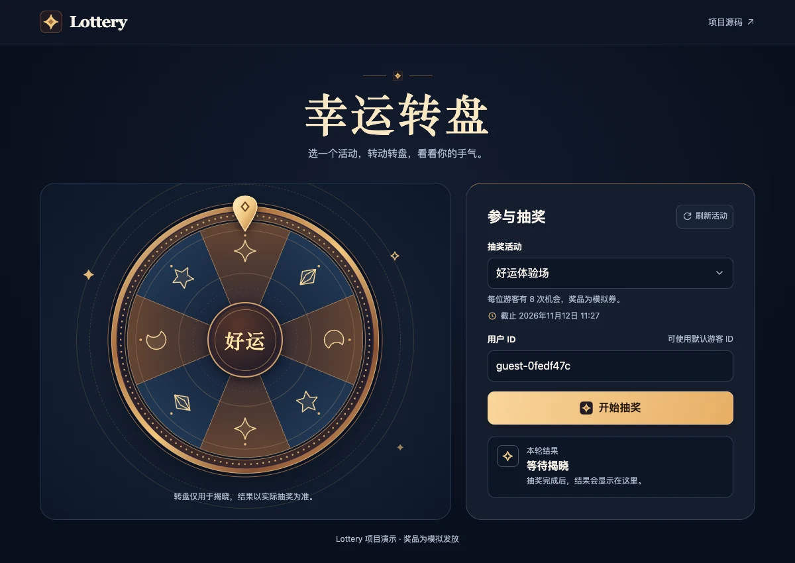
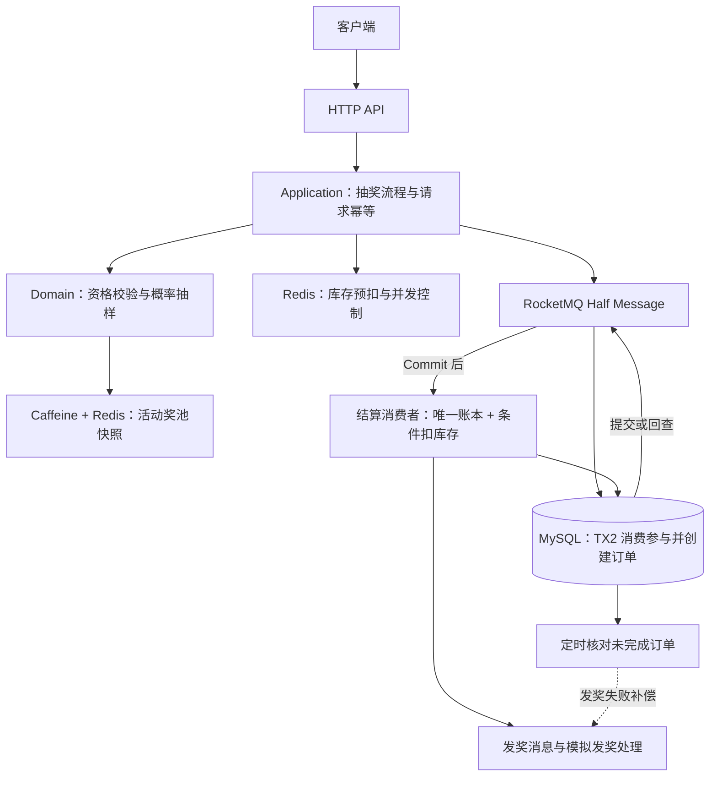

# Lottery · 高并发抽奖与异步发奖系统

> 基于 Java / Spring Boot 的电商营销抽奖系统，围绕高并发库存控制、请求幂等、异步结算及故障恢复展开工程实践。


**Lottery 是一个以学习和技术实践为目的的 Java 后端项目，并非实际生产部署的商业系统。** 项目模拟营销抽奖业务，涵盖活动配置、参与资格校验、概率抽奖、中奖订单和异步发奖，重点研究系统在重复请求、库存竞争、消息重投及部分组件故障下如何维持业务正确性。

技术栈：**Spring Boot · MyBatis · MySQL · Redis · Caffeine · RocketMQ · Spring Scheduling · Maven · JMeter**

## 网页演示

启动后端后，打开 [幸运转盘](http://localhost:8080/) 即可选择活动、点击抽奖并查看结果。页面和 API 随同一个 Spring Boot WAR 发布，无需单独构建前端。想从空环境跑一场可抽的活动，可按 [本地演示步骤](docs/web-demo.md) 准备独立演示数据。



## 核心特性

| 主题 | 设计与实现 |
| --- | --- |
| 参与约束 | 用户受个人 `take_count` 限制，活动没有独立的总抽奖名额 |
| 奖品库存 | Redis 原子预扣控制活动奖品库存，MySQL 条件更新完成持久化结算 |
| 请求幂等 | `requestId` 标识一次逻辑抽奖，配合数据库唯一约束、未完成参与恢复和结果回放 |
| 可靠异步结算 | 订单 TX2 通过 RocketMQ 事务消息驱动异步库存结算，回查读取已提交订单 |
| 消费幂等与补偿 | `UNIQUE(order_id)` 结算账本、状态 CAS 和 Spring 定时扫描处理重复消费与失败恢复 |
| 缓存与数据组织 | Caffeine + Redis 两级奖池缓存，单 MySQL 库和七张业务表 |
| 验证与性能 | 单元测试、真实中间件 E2E、JMeter 压测及 SQL 执行计划对照实验 |

## 系统架构

项目以 **单体部署、Maven 多模块分层** 为基础，分离 HTTP 接口、用例编排、业务规则和基础设施实现。



一次抽奖的主要过程如下：

1. HTTP 校验认证用户，按本机并发与 Redis 配额准入，再进入应用层编排。
2. 通过短时并发锁、请求号及参与记录，判断是新请求、结果回放还是未完成请求恢复。
3. 校验活动状态和时间；TX1 在同一个本地事务中条件扣减个人次数并创建参与记录。
4. 读取活动奖池快照进行加权随机抽样。命中奖品先发送 Half Message，Broker 确认后进入 TX2。
5. TX2 用参与 CAS 取得行锁，在 Redis 原子预扣并登记对账记录，再提交中奖订单。未中奖和真实售罄仍消费一次参与。
6. RocketMQ 收到 Commit 后投递库存消息。TX3 写唯一账本并条件扣减 MySQL，库存终态 CAS 同时登记发奖义务。

## 关键技术设计

### 1. 库存一致性：Redis 预扣与 MySQL 结算

- **Redis** 按 `activityId + awardId` 原子预扣奖品库存，避免每次中奖直接竞争 MySQL 库存行；活动自身不维护库存。
- **MySQL** 保留持久化记录，奖品库存采用 `surplus > 0` 条件更新，阻止并发结算导致负库存。
- 活动启动在活动行锁内检查 READY 和时间窗口，以 MySQL 奖品余量 SETNX 预热后 CAS 到 RUNNING。各活动引用同一奖品时使用独立概率和库存。
- 奖品库存 Key 缺失时明确报错，保留原未消费 take 与 requestId；只有真实售罄才视为未中奖。已运行或关闭的活动缺 Key 须先对账，不能用滞后 MySQL 值回填。

系统仅保留“用户个人参与次数”和“活动奖品库存”两种限制。旧活动总库存的 MySQL 剩余量没有完整结算链路，本次取消全场名额限制并移除两列及 Redis 预扣/回补；详见 [业务简化与迁移](docs/activity-stock-removal.md)。

Redis Lua 将预扣和对账索引一起写入。JVM 退出或提交结果未知时，通过 MySQL 参与锁和订单检查决定归还预扣或清除记录。同请求重试也会清理该参与已回滚的预扣。

### 2. 请求幂等：同一次抽奖只消耗一次机会

短时 Redis 锁负责抑制并发重复进入，**持久化幂等** 则依靠请求号与数据库约束，而非依赖锁的有效期。

- 客户端为每次新的逻辑抽奖生成独立 `requestId`。
- 网络超时后复用原请求号，已完成请求回放原中奖或未中奖结果。
- 参与已登记但尚未消费时，恢复原参与记录，不额外扣减参与次数。
- 数据库唯一约束兜底并发竞争；锁采用随机 token 和 compare-and-delete 防止误删他人的锁。

相关设计见 [抽奖请求幂等说明](docs/draw-request-idempotency.md)。

### 3. 事务消息、结算与发奖补偿

RocketMQ 根据 TX2 的提交结果释放或回滚库存 Half Message。进程重启后，同一生产者组以订单事实处理 Broker 回查。库存条件扣减和唯一账本在 TX3 提交，消费重放继续由账本和订单 CAS 去重。

库存分歧进入 **BLOCKED**，对账后才能重新投递。订单还保留库存超时核对，以及库存完成后需要发送的发奖义务。四种发奖处理器当前只写本地模拟状态。 [事务协议与验证](docs/rocketmq-transactional-report.md)

### 4. 概率抽奖与热点缓存

- 使用 `BigDecimal` 将奖品概率转换为整数权重，通过随机整数、前缀和与二分查找完成抽样。
- 配置概率总和不足 100% 时，剩余概率归入 `NO_PRIZE`；命中已售罄奖品不会重新分配其他奖品的概率。
- 对高频读取、低频变更的活动奖池快照使用 **Caffeine L1 + Redis L2** 两级缓存，接受短 TTL 内的配置最终一致性。

### 5. 单库与抽奖准入

七张业务表共用一个 MySQL 数据库和一个 Hikari 连接池。订单号、参与号、请求归属和库存账本分别由唯一约束保护。RocketMQ 分支使用当前 Schema 新建隔离库。

抽奖使用 Servlet 认证身份。Controller 先获取本机 Semaphore 许可，再用一条 Redis Lua 同时检查全局和用户活动令牌桶。429 或限流 Redis 故障返回 503 时，可以用原请求号重试。详见 [抽奖 HTTP 契约](.trellis/spec/backend/http-contract.md)。

## 性能测试与优化

项目使用 JMeter 和独立 Docker 中间件环境测试 **HTTP → RocketMQ 事务消息 → MySQL 库存账本 → 本地模拟发奖** 的真实链路，并针对 SQL 扫描和 JDBC 往返做定向分析。

### 补偿任务查询优化

对约 **43.1 万条历史订单** 的发奖补偿空扫描进行索引实验，使用相同数据、执行计划及索引可见性正反向对照核验结果。

| 指标 | 优化前 | 优化后 |
| --- | ---: | ---: |
| 补偿空扫描检查行数 | 430,953 | 0 |
| Handler 平均耗时 | 248.87 ms | 6.15 ms |

该数据表示**特定补偿扫描路径**的优化效果，不等于系统整体吞吐提升相同比例。

### 完整链路持续负载

以下为 2026-10 的历史双库存实现数据。RocketMQ 四档数据见 [重构报告](docs/rocketmq-transactional-report.md)。在当时的本地单应用、单 Kafka Broker、模拟发奖条件下：

- **150 RPS** 完成两次连续 **300 秒** 的完整异步链路验收，满足预设 HTTP、积压增长、异步完成和最终业务审计条件。
- 更高的 **180 / 200 RPS** 长时间测试未全部满足稳定性条件；150 RPS 的早期一次测试也未通过，因此不能据此认定最大稳定容量。
- 曾测得 **328.9 RPS** 的短时 HTTP 入口吞吐，但该轮产生明显异步积压，**不作为稳定全链路吞吐**。

相关证据与复现方法：

- [性能压测与优化报告](doc/performance/optimization-report.md)
- [性能测试环境与运行步骤](doc/performance/README.md)
- [JDBC 与持续负载验证记录](doc/performance/results/20261013-jdbc-session/README.md)
- [稳定性验收标准](doc/performance/stability.md)

## 构建与运行

### 环境依赖

- Java 8、Maven 3.x（项目使用 Spring Boot 2.3.5.RELEASE）
- MySQL 8.0、Redis、RocketMQ 5.3.4

### 本地构建

```bash
git clone https://github.com/kaguranananana/lottery.git
cd lottery

# 默认单元测试（不需要启动外部中间件）
mvn clean test

# 构建 Spring Boot WAR
mvn clean package
```

构建产物为 `lottery-interfaces/target/Lottery.war`。

### 数据初始化与应用启动

1. 准备独立的 MySQL 测试实例。
2. 执行 [完整 Schema](docs/sql/lottery-schema.sql)，可选加载 [演示数据](docs/sql/lottery-demo-seed.sql)。
3. 配置 MySQL、Redis 和 RocketMQ NameServer。默认端口分别为 13306、6379、9876。
4. 预建库存事务 Topic 与发奖普通 Topic 后启动应用。活动按正常状态流转完成预热。 [独立环境命令](docs/rocketmq-transactional-report.md)


本地单实例的 Snowflake 节点默认 `LOTTERY_WORKER_ID=0`、`LOTTERY_DATACENTER_ID=1`。多实例部署必须给同一数据中心内每个实例分配不同的 0..31 worker-id；节点号不再从 IP 推导，也没有自动注册分配。

```bash
java -jar lottery-interfaces/target/Lottery.war --server.address=127.0.0.1 --lottery.draw.local-demo-user=u1
```

以上启动参数启用固定本机演示账户。正式部署由身份集成为请求建立 Servlet Principal。浏览器可打开 [http://localhost:8080/](http://localhost:8080/) 参与抽奖。也可直接调用 HTTP 接口：

```bash
curl http://localhost:8080/api/v1/activities

curl -X POST http://localhost:8080/api/v1/draw \
  -H 'Content-Type: application/json' \
  -d '{"userId":"u1","activityId":100001,"requestId":"example-draw-001"}'
```

示例 `activityId` 和 `userId` 须替换为当前测试库中已配置并满足参与条件的数据；同一次抽奖重试应保留原 `requestId`。仓库的性能测试环境、数据准备及完整复现步骤另见 [性能测试指南](doc/performance/README.md)。

## 测试与验证

仓库提供概率抽样、请求幂等、并发锁、状态推进和消息回调等单元测试，以及使用真实 MySQL、Redis、RocketMQ 的集成与 E2E 测试。

- 默认单元测试通过 Maven `mvn clean test` 执行。
- `*ManualIT` 集成测试需要专用中间件、数据库初始化和测试配置；部分场景会修改专用测试库或停启 Broker，**不要直接对现有业务环境批量运行**。
- 完整 E2E 覆盖真实 HTTP 请求、多个用户的请求归属、库存结算、消息重复投递、故障恢复和本地模拟发奖。

本次业务简化的实际命令、结果和覆盖边界见 [2026-11-02 重构验证](docs/activity-stock-removal.md)。历史测试环境与证据见 [正确性与 E2E 验证](docs/final-correctness-e2e.md)。
后续库存异常、事务回补与缓存时序修复，以及当前剩余 failure case，见 [2026-10-24 故障评估](docs/failure-review-20261024.md)。

## 项目结构

```text
lottery-interfaces        Spring Boot 启动入口、抽奖网页、HTTP API、测试
lottery-application       抽奖流程编排、RocketMQ 生产/消费、Spring 定时任务
lottery-domain            资格校验、奖池抽样、活动与订单业务规则
lottery-infrastructure    MyBatis / Redis / Repository / 缓存实现
lottery-common            统一结果、枚举与公共常量

docs/sql                  当前完整 Schema、演示数据与升级脚本
doc/sql                   历史基线、种子及索引迁移
doc/performance           压测工具、报告与验证证据
docs                      架构、幂等、一致性与 E2E 设计文档
```

## 实现边界

本项目主要用于学习后端系统在并发、异步和故障场景下的工程设计，当前仍有以下边界：

- 发奖处理为 **本地模拟适配器**，未接入真实优惠券、物流或第三方发奖平台。
- Kafka 测试环境采用单 Broker / 单副本，不代表生产级高可用或跨机房容灾。
- Redis 运行期库存 Key 丢失需要独立对账恢复，尚无自动化跨存储对账流程。
- 压测数字仅对应所记录的本地环境、数据量及测试方法，不代表生产 SLA 或确定的最大吞吐上限。

## 延伸阅读

- [取消活动总库存：流程、迁移与验证](docs/activity-stock-removal.md)
- [架构设计与组件取舍](docs/architecture.md)
- [活动独立奖池与 V8 切换](docs/activity-prize-pool.md)
- [抽奖请求幂等](docs/draw-request-idempotency.md)
- [Kafka 消息状态与 CAS](docs/kafka-mq-state-cas.md)
- [正确性与 E2E 验证](docs/final-correctness-e2e.md)
- [性能测试与优化报告](doc/performance/optimization-report.md)
