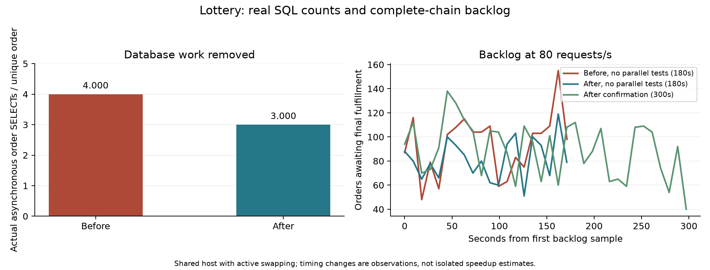

# 真实链路性能诊断与独立优化记录

执行日期：2026-10-12 至 2026-10-13，Asia/Shanghai。上一轮完成三个独立优化：已有次数行跳过无变化 upsert、应用仓库已有库存组合索引、移除 Outbox 扫描后的逐订单重复查询。总库存字段缺陷另行修复。上一轮证据在 [结果目录](results/20261012-optimization/README.md)，首次 [压测报告](report.md) 与 `20261012-final` 原始结果保持原样。

## 最新收尾：JDBC往返、驱动事务修复与容量边界

**当前最高已实测通过的候选是本地150RPS，两次连续300秒测量均满足原定完整异步标准。首轮150长测曾失败，180/200长测失败，精确最高容量仍未认证。** 本轮实际交付两项性能优化和一个独立驱动正确性修复，没有把HTTP吞吐或最终排空当持续容量，未改变持久化1/1、库存账本、唯一约束、状态CAS、池/并发或Kafka提交策略。

补偿索引独立提交`9310207`：同430953历史订单、六轮交替原条件计划，空扫描430953→0行；80RPS原版→可见索引→不可见反向，handler均值248.87→6.15→249.56ms。支持读路径/阶段成本因果收益，不能把局部毫秒比例换算成服务吞吐倍数。索引插入和发奖维护成本保留，详细原始阶段见下文及[索引证据](results/20261013-capacity-scan/README.md)。

200RPS旧驱动诊断发现唯一producer网络线程在同步MySQL回调等待，437733次额外只读状态SELECT、39971订单。尝试会话缓存前，真实门禁复现8.0.28/true首次Spring回滚不生效，General Log证明漏发关闭自动提交；false正常，业务应用未在危险组合下启动。保持断言，将驱动升到首个官方修复8.0.29，独立提交`94b790e`，没有预热SELECT或强制SET兼容分支。依据[官方缺陷](https://bugs.mysql.com/bug.php?id=106435)与[8.0.29说明](https://dev.mysql.com/doc/relnotes/connector-j/en/news-8-0-29.html)，真实失败与修复见[记录](results/20261013-jdbc-session/driver-fix.md)。

性能项仅在生产及性能覆盖的三条URL添加`useLocalSessionState=true`，JDBC维护状态、Hikari归还重置；只读仍传播到服务器，`useLocalTransactionState`默认false。未来直接SQL SET会话状态会绕过缓存，契约和真实门禁写入数据库规范。业务Java/Mapper与回调执行模型未改。

| 同8.0.29、200RPS、180秒 | false | true |
|---|---:|---:|
| 唯一新抽奖RPS | 199.794 | 199.811 |
| HTTP P95/P99 ms | 27/33 | 27/33 |
| 异步P95上界 ms | 3228 | 3094 |
| 发奖积压峰值/首尾平均增长 | 493/48.00 | 448/157.29 |
| 排空秒 | 0.539 | 0.682 |
| 额外只读SELECT | 437907 | 0 |
| 显式COMMIT | 119742 | 119699 |
| MySQL平均CPU（单核100%） | 124.63% | 101.63% |
| producer线程SQL累计秒（含预热/排空） | 169.15 | 148.23 |
| Swap-in/out MiB | 0.125/0 | 1.297/0 |
| 原稳定判断/业务审计 | 通过/通过 | 通过/通过 |

每单约10.957次驱动状态查询→0可复现，十次API查询的独立探针为10→0服务器SELECT，真实COMMIT/rollback保留。CPU和累计回调更低是本机观察，历史增加39967订单、I/O/缓存及背景波动未完全分离，不能认证精确比例。两侧P99相同、两侧都通过180秒，不能说缓存“使200RPS从失败变稳定”。

| true配置持续复核 | 测量秒 | 新抽奖RPS | HTTP P95/P99 ms | 异步P95上界 ms | 积压峰值/增长 | 排空秒 | 判定 |
|---|---:|---:|---:|---:|---:|---:|---|
| 250探索 | 180 | 249.706 | 62/234 | 61366 | 12525/9635.29 | 60.581 | 失败 |
| 225探索 | 180 | 224.756 | 31/41 | 8566 | 1769/721.43 | 5.861 | 失败 |
| 200长测 | 300 | 199.627 | 34/111 | 5648 | 1423/392.29 | 6.299 | 失败 |
| 180长测 | 300 | 179.907 | 55/196 | 32694 | 5917/5085.14 | 24.424 | 失败 |
| 150首轮长测 | 300 | 149.930 | 88/228 | 4161 | 559/247.14 | 3.604 | 失败 |
| 150应用恢复后复测 | 300 | 149.937 | 19/23 | 2061 | 163/8.57 | 0.830 | 通过 |
| 150同JVM连续复测 | 300 | 149.940 | 58/254 | 2980 | 391/128.00 | 0.691 | 通过 |

所有正常轮HTTP/系统错误0、最终逐ID/次数/库存/账本/状态/Kafka审计通过。原标准不变，150首轮和200长测只因积压增长失败也保留；最终审计通过不是稳定通过。150～180是后续需要复核的区间，不是已证明单调的精确容量夹逼；未测速率、不同时长/历史量与生产环境不作保证。150复测间只停止/恢复应用，broker、数据库和配置未改变；不把较好结果归因于重启或代码。两次通过的P99为23/254ms，必须一起引用。

资源复核确认无额外高负载进程，最后两段各30秒空闲复核无换页；JDBC阶段九个容量轮仅少量Swap-in、无Swap-out。MySQL 2CPU/2GiB、Kafka 2CPU/1GiB和Mac16GiB限制保留。容器触及memory.max、持久日志I/O、真实奖品行锁、状态写入与单producer同步回调仍需调查；末段150回调SQL1.4→3.1ms、库存消费10→22ms，与积压增长同时发生，具体贡献比例未分离。broker九轮GC无Full GC，最大约198ms，应用无Old GC、池无等待/超时，不能把几十秒延迟都归为GC。重复消费者读取约0.9ms/次，尚未验证其容量收益，没有顺带改服务接口或批量回调。

默认35项单测及最终当前缓存参数下11项真实MySQL测试共46项通过；热点/同ID/真实1ms超时/D007恢复、真实Kafka各2条重投、有限活动100单与五奖品各10份均通过。全库最终961360唯一订单/账本、1005414已消费参与、4144017次数行，无关联缺失、负数、BLOCKED或未完成；整个本轮新增578425订单、582351参与，不把旧数据算新增。最终961360历史下补偿/库存空扫描均读0行。

专用应用/JMeter与四容器已停止，原五实例状态/挂载/限制不变，数据卷和全部原始证据保留。MySQL/Redis退出0，Kafka/ZooKeeper为Java SIGTERM的143，均无OOM，MySQL与Kafka关闭日志完整；初次收尾检查错误要求四者都0，已按运行时协议纠正并记录。最高候选已复测、正确性闭环完成；没有新的最小修改收益证据时停止代码迭代，保留持久提交与消息语义，下一项先控制I/O/资源状态再验证。

可用于简历/面试的是执行树与反向实验、每单约11次驱动查询消除、先失败的真实回滚测试及最小官方驱动修复、完整异步150RPS两次300秒验收和保留失败的容量解释。不能写成生产稳定QPS、服务提升倍数或精确CPU收益；第三方渠道、broker HA、XXL admin及多实例未覆盖。完整九轮数据、作用边界、复现及面试追问见[最终证据](results/20261013-jdbc-session/README.md)。

## 历史阶段记录

**上一轮重启后结果：Mac 重启后，以 `b198ed6` 的业务版本复测 80 RPS；180 秒测量和同速率 300 秒确认均通过原定稳定标准，全程未观察到 Swap-in/out。没有升压或修改业务实现，最大稳定吞吐仍未测定。** 新证据见 [重启后基线结果](results/20261013-reboot-baseline/README.md)。

重启前，以 main `34cd882` 为基线的资源预检和只读 SQL 诊断因持续主动换页及共享负载停止，没有产生完整链路吞吐结果，提交为 `b198ed6`。该历史停止记录及执行计划见 [重启前证据](results/20261013-rediagnosis/README.md)。以下各轮记录分别保留，不将本轮新结果改写为旧轮次的通过结果。

**上一轮能够确定的是锁机制和数据库操作减少；不能据本机数据认证生产容量或给出可信的整体提升比例。** 当时宿主机持续使用约 11.9 GiB Swap，前后轮次的主动换页量不同，数据库体量也随保留历史数据而增长。报告保留真实 HTTP、异步与数据库指标，包括未通过的结果。

## 2026-10-13：补偿索引单变量验证与更高负载诊断

以4b93c95继续复查环境后，原80RPS重新通过180秒。唯一实际优化是两库八表增加单列非唯一idx_invoice_grant_state(grant_state)，保留原补偿谓词、消息CAS、库存账本和全部持久化语义。同数据430953历史订单的六轮交替计划：空扫描原读430953行、新读0；零Swap增量批次八表根节点耗时合计约191~202ms对0.095~0.102ms。真实混合状态测试返回集合不变，含grant_state=2与NULL原语义。

同80RPS原版→可见索引→不可见反向：补偿handler均值248.87→6.15→249.56ms，SQL examined全轮6253万→1.536万→6808万行；MySQL平均CPU55.06→33.51→50.94%（单核100%）。反向索引仍被写入维护，三轮历史量递增且都有少量Swap-in，支持读路径/阶段成本机制，不认证精确整体CPU或HTTP延迟提升比例。索引初始分配约12.125MiB，单列减少不必要的stock状态键维护；插入与grant推进仍有写成本。默认35项及真实SQL8项共43项通过，所有基准逐ID/库存/账本/Kafka审计通过。

索引版本100及150RPS均通过180秒，200RPS同步199.83、P99 50ms，但异步积压峰值4440、P95上界23.891秒、排空19.020秒，原四项异步条件失败。该轮Swap-in0.5625MiB、无Swap-out及池等待/超时，不能归因于宿主机换页。最高候选的300秒确认与进一步容量夹逼尚待完成，不能宣称最高稳定吞吐已经认证。

200RPS三份线程现场发现唯一Kafka producer网络线程在回调中等待MySQL，其中一次处于Connector/J 8.0.28的只读会话状态查询。同步回调/驱动往返是下一项独立实验，不直接添加线程池或关闭CAS。此时尚未修改驱动配置或认证该候选收益。详细参数、反向实验、失败边界及复现见[本轮证据](results/20261013-capacity-scan/README.md)。

## 重启后：80 RPS 基线复测（2026-10-13）

### 恢复环境与资源验收

Mac 已重新启动，初始 Docker Desktop 未运行，Swap 存量及 Swap-in/out 累计均为 0。先观察宿主，再恢复 Docker：九个原容器及挂载均保留，其它五实例在重启后处于停止状态，本轮始终没有启动或修改它们。只启动原 `lottery-perf` 四容器，未调用 init/clean/compose up、删除 Volume 或重建实例。

宿主仍为 10 CPU/16 GiB，Docker VM 10 CPU/约 7.65 GiB；MySQL 2 CPU/2 GiB、Kafka 2 CPU/1 GiB、Redis 1 CPU/256 MiB、ZooKeeper 0.5 CPU/384 MiB 均保持原限制。MySQL 8.0.46、128 MiB buffer pool、REPEATABLE READ、持久化参数 1/1 不变。应用与 JMeter 保持原堆与可用处理器配置，使用 JDK 17.0.18、JMeter 5.6.3，构建/下载结束后才正式测量。

| 资源窗口 | 观察秒 | Swap-in / Swap-out MiB |
|---|---:|---:|
| 无 Docker 的宿主 | 60.032 | 0 / 0 |
| Docker 空闲，九容器未运行 | 60.042 | 0 / 0 |
| 专用四容器空闲 | 60.028 | 0 / 0 |
| 原应用空闲 | 60.025 | 0 / 0 |
| 180 秒及300秒测量的资源采样 | 各全轮采样 | 0 / 0 |

内存压力原始读数为 1，memory_pressure 原文、进程 RSS、Docker 端点与测试中的持续资源记录均保留。关闭测试资源后，Swap-in/out **自本次开机以来的累计计数仍均为 0**，覆盖了活动/用户准备、预热、正式测量、排空和功能验证的间隙。本轮未出现重启前停止依据中的明显主动换页及活跃背景容器负载，因此允许原定 80 RPS 复测；没有改变停止依据或业务验收门槛。

恢复后只读核对精确初始体量：341,311 条唯一订单/账本、381,439 条参与、2,424,009 条次数行，与 `b198ed6` 记录相同。没有删除或回填历史数据。两轮各增加10万用户的活动次数 fixture；两活动使用同一组用户标识和生产路由，每活动独立次数/请求归属。新活动ID为740201/740202，测量顺序固定为180秒→300秒，各自前后完整排空。

### 本轮新测量结果

真实 HTTP→Redis→两库八表 MySQL→Outbox→Kafka→库存账本→本地模拟发奖保持完整。两轮均为30线程、20秒预热、80 RPS固定到达速率、100%中奖、活动及每奖品100万库存；正式测量期间没有并行构建、下载、手工 SQL 用例或其它实例负载。

| 指标 | 180 秒测量 | 同速率300秒确认 |
|---|---:|---:|
| 实际唯一新抽奖 RPS | 80.000 | 80.013 |
| 测量窗口新订单 | 14,400 | 24,004 |
| 全轮订单（含预热） | 16,007 | 25,613 |
| HTTP 平均/P95/P99 ms | 10.96 / 19 / 23 | 10.68 / 18 / 22 |
| HTTP/系统错误率 | 0% / 0% | 0% / 0% |
| 采样发奖积压峰值 | 100 | 105 |
| 首尾60秒平均积压增长 | 3.71 | 5.86 |
| HTTP后异步P95保守上界 ms | 2,105 | 2,116 |
| 入口结束后排空秒 | 0.331 | 0.326 |
| 最终两个Kafka组Lag | 0 / 0 | 0 / 0 |
| 全量业务审计/原稳定条件 | 通过 / 全部通过 | 通过 / 全部通过 |

原 `check_stability.py` 九个条件全部通过，没有修改标准。峰值来自约9秒级异步采样，不能称为未采样瞬间的绝对最大值；异步完成时间仍为秒精度的一秒宽上界，不冒充精确毫秒。80.013是按请求完成时间计算的窗口波动，不是升压。

MySQL 测量窗口平均CPU约42.99%/43.35%、采样峰值62.62%/71.54%，Kafka约66.53%/59.74%、采样峰值190.07%/146.23%；Docker以单核100%表示。MySQL内存采样峰值672.9/755.3 MiB，Kafka743.3/762.4 MiB，连接池无获取超时或等待饱和、无OOM和任务异常。实际仍有行锁等待增量2,894次/3,463ms、4,699次/5,482ms；零换页不等于零锁竞争，累计等待不能视为墙钟或CPU耗时。

确认轮全轮（包含预热/排空）的阶段均值：补偿handler194.42ms、库存Outbox handler48.08ms、库存/发奖消费10.50/8.21ms、账本结算仓储5.27ms。生产者库存/发奖回调SQL均值约2.00/1.04ms，原生ack约0.95/0.91ms。计时包含式且有嵌套，不能相加算CPU占比；它们是原实现的成本观测，没有实施优化。补偿扫描、消费事务、回调和Outbox更高负载下的容量影响仍待独立验证。

### 正确性、工具事件与结论边界

原 `analyze.py` 逐ID核对本轮两个基准活动的请求、take、order、唯一账本、次数、Redis/MySQL奖品库存、最终消息/模拟发奖状态；均通过。另用原 `semantics.py` 在独立活动740210验证：同/不同requestId热点各1次成功、49次D006；客户端确实发生读取超时，同ID恢复仍仅1单；D007返回原请求归属、恢复原take。四类用户各只有一个新抽奖。原 `message_replay.py` 真实重投2条库存、2条发奖消息，库存/次数/订单/参与/账本/状态未变，两组实际消费位点增长且Lag归零。

本轮新增41,624条订单/参与/唯一账本；最终全部三库为382,935条唯一订单及账本、423,063条参与，次数消耗一致，无未消费参与、关联缺失、负次数/奖品库存、BLOCKED或异步未完成。旧341,311单与本轮新增明确分开；全量MySQL核对与本轮活动的Redis/Kafka审计范围分别记录。

工具恢复与收尾的失败保留原始记录，不计为压测失败：官方JMeter下载120秒实际超时，随后从上轮同源镜像恢复相同5.6.3至持久缓存；Docker Mounts数组顺序变化导致初始列表比较失败，逐挂载核实名称/目标/类型完全一致；`stop.py` 错误要求Java的comm带 `/java` 后缀，拒绝了本轮实际名为 `java` 的专用进程。最后一项用真实PID复现旧校验失败后，最小修改为按可执行文件名识别，仍同时核对 `PerfHarness` 主类；修复后正常SIGTERM关闭，非专用进程仍被拒绝。该修改仅影响收尾工具，不改变本轮已经完成的业务版本或测量。

专用应用及四容器已正常停止，MySQL退出0、OOMKilled=false，60秒关闭宽限，原数据卷全部保留；其它五实例维持重启后状态。本轮没有修改Java、Mapper、索引、事务、ack或持久参数，没有执行删除数据的ManualIT，也没有重新运行业务单元测试；验证来自原业务版本的真实链路、幂等/重投及审计。所有原始日志/JTL/逐ID导出、资源与SQL采样保留并打包。

**可以确认的是当前本地、单应用、单broker、现有历史体量及模拟发奖条件下，80 RPS重新通过180秒和300秒标准。** 没有更高速率的通过/失败夹逼，不能宣称最大稳定吞吐或生产容量。没有性能实现改动或受控重启A/B，不能将相对旧轮次更低的延迟写成代码优化收益，也不能量化“重启提升多少倍”。本轮事实可用于面试说明真实链路80 RPS持续验收、零换页环境及4.16万新增业务一致性验证；第三方发奖、broker HA/故障恢复与生产SLA均未验证。

## b198ed6：重启前环境停止与补偿扫描的实际工作量

### 资源核实与停止依据

宿主为 10 CPU、16 GiB 内存，Docker VM 可用 10 CPU、约 7.65 GiB 内存。预检时 Swap 已用约 8.9 GiB；没有仅凭存量判断压力，而是在未启动本轮应用、JMeter 或中间件时连续采样两段约 60 秒。另一次采样覆盖专用 MySQL 的只读诊断窗口。

| 窗口 | 实际观察秒 | Swap-in MiB | Swap-out MiB | 本轮负载 |
|---|---:|---:|---:|---|
| preflight-1 | 60.047 | 33.58 | 0 | 专用四容器、应用及 JMeter 均未运行 |
| preflight-2 | 59.988 | 81.75 | 0 | 同上 |
| mysql-observation | 60.023 | 597.00 | 178.45 | 仅启动专用 MySQL，读取体量、计划与持久化事实 |

原有五个非本轮容器始终运行，均未设置 CPU/内存上限；背景 Kafka 的端点快照约使用 2.49 GiB、约一个 CPU 核。它与主动换页同时存在，**没有证明它单独造成了换页，也没有量化它对 Lottery 的性能影响**。本轮专用栈起初全部停止，已无可释放的本轮活跃负载；消除共享干扰需要操作其它实例或使用独立环境，超出本轮授权边界。没有停止它们、改变 Docker VM 资源、清理数据或关闭 Swap。

复用保留的专用 MySQL 只做只读诊断，没有启动 Redis、Kafka、ZooKeeper、应用及 JMeter。实际 MySQL 为 8.0.46，2 CPU/2 GiB，128 MiB buffer pool，REPEATABLE READ，`innodb_flush_log_at_trx_commit=1`、`sync_binlog=1`。其它专用限制仍为 Kafka 2 CPU/1 GiB、Redis 1 CPU/256 MiB、ZooKeeper 0.5 CPU/384 MiB。诊断结束以 60 秒宽限关闭 MySQL，退出 0、OOMKilled=false；数据卷保留，五个背景实例的状态、资源限制、端口与挂载身份前后相同。

这不是新的业务稳定性失败轮次。环境在复测基线之前即未满足本轮可靠归因条件，因此原版 80 RPS 复测、定速升压、A/B、真实 Kafka 重投及新链路审计均标记 **未执行**，没有降低 [既有阈值](stability.md)，也没有将未执行写成通过。

### 新确认的扫描机制

当前精确数据量为：32 个活动、160 条策略明细、341,311 条订单与同量结算账本、381,439 条参与记录、2,424,009 条次数行。每张订单表有 42,576～42,757 条记录。本轮不新增活动或业务数据，两次采集的计数一致；`information_schema.table_rows` 仅作为估算另外保存。

`mysql_diagnosis.py` 直接提取生产 `UserStrategyExport_Mapper.xml` 中的补偿/库存 SQL，替换为实际两库八表，分别执行 EXPLAIN 和三次 EXPLAIN ANALYZE；没有手写一个近似查询来替代真实条件。两次只读采集得到：

| 查询 | 每次八表索引迭代器读取行数 | 返回候选 | 第一次采集三次根节点耗时合计 ms | 第二次采集三次根节点耗时合计 ms |
|---|---:|---:|---|---|
| 发奖补偿 | 341,311 | 0 | 628.9 / 226.8 / 230.7 | 231.8 / 171.3 / 174.1 |
| 库存 Outbox | 0 | 0 | 0.166 / 0.198 / 0.162 | 0.213 / 0.196 / 0.152 |

这里每个数字都是同一次重复中八个查询根节点的墙钟耗时之和，**不是整个 handler 耗时、CPU 时间、完整链路延迟或优化收益**。查询逐表重复执行，缓存及执行顺序并未随机化，且宿主仍换页；628.9→171.3 不能写成性能提升。

八张表的补偿计划都使用已有 `idx_stock_mq_state_create_time` 以 `stock_mq_state=1` 定位，再对 `grant_state != 1` 及消息/超时条件过滤。现存订单全部为 stock/mq/grant=1/1/1，所以库存完成条件命中所有订单，索引迭代器仍读取整份历史，最后过滤为零。`LIMIT 100` 限制返回候选，无法避免没有候选时扫描完 341,311 行。

这把上一轮“补偿扫描有成本”的观测推进到具体的**定位条件选择性不足、未完成发奖条件在索引定位之后过滤**的实际计划证据。当前无积压时库存 Outbox 能使用已有状态索引读零行，不能据此断言高负载时投递没有成本。旧 `mq_state/create_time` 索引仍未部署；没有仅因它存在于旧脚本就直接部署或断言足以解决当前查询。

下一项可验证实验应让补偿扫描尽早定位未完成发奖订单，并验证全部 INIT/FAIL/超时 SENT、旧 COMPLETE 未发奖、BLOCKED 排除及并发消费边界；索引还会增加真实状态更新的维护成本，须在受控环境对照整体链路后决定。**本轮没有添加索引或修改 SQL。**

### 正确性核对、遗留与容量边界

两次 MySQL 核对均得到 341,311 个唯一订单、唯一 take 关联及唯一账本，订单→账本/参与关联不匹配为零；无未消费参与、负次数、负奖品库存、BLOCKED 或未完成订单。两库次数消耗 190,661+190,778=381,439，与参与总量相同。只读诊断期间订单数未变。范围覆盖全部现存三库数据；上一轮优化报告的 155,557 单仅覆盖其活动列表，不能将总量差异解释为本轮新增吞吐。

Redis 库存、Kafka Lag、请求重放及真实发奖收敛本轮没有运行，**上述核对不等于新的完整业务一致性验收**。没有修改 Java、Mapper、事务、消息状态 CAS、幂等约束、ack 或持久化参数。新诊断脚本已真实运行并做语法及证据一致性检查；没有业务优化，因此没有用旧的 54 项结果冒充本轮单元/集成测试。

消费者的账本事务、状态更新及两次订单查询、Kafka 发送回调的同步数据库写入、Outbox claim/enqueue/回调成本仍须在可信完整链路下测量。本轮没有产生新阶段耗时或高负载锁等待证据；只读窗口锁等待为零不证明压力下无锁竞争。补偿扫描读放大已定位，但其容量影响和最佳修复方案尚未验证；共享环境是停止实验的原因，不作为业务根因替代品。

当前仍只能引用上一轮最终版本**通过既定标准的本地 80 RPS 历史候选**。本轮没有新增稳定区间、较高失败档位或最大稳定吞吐夹逼，不能声称已认证当前机器或生产的最大容量，也不能将所有低于 80 的未测速率自动宣称稳定。

简历/面试可新增事实：建立只读资源预检，识别持续主动换页并停止不可归因的性能实验；用生产 SQL 的 EXPLAIN ANALYZE 证明补偿空扫描每轮读取 34.13 万历史订单，核对 34.13 万订单/账本及 38.14 万参与的 MySQL 持久化一致性。不能宣称本轮已优化扫描、实现吞吐或延迟提升、完成新真实链路审计、解决生产者/消费事务瓶颈或达到生产 QPS。上一轮“异步订单 SELECT 4→3”等可验证事实仍沿用其原有边界。

## 1. 环境、口径与反馈闭环

复用 `lottery-perf` 专用栈的原有容器和历史数据，不清库，不停止原有五个测试容器。Compose 启动因镜像仓库认证连接失败退出，随后直接启动已有专用容器，没有重建实例。MySQL 8.0.46、Redis 7.2.16、Kafka 2.8.1 保持原配置；MySQL 2 CPU/2 GiB、128 MiB buffer pool、REPEATABLE READ、`innodb_flush_log_at_trx_commit=1`、`sync_binlog=1`，Kafka 单 broker、单副本、acks=1。应用仍为 512/1024 MiB 堆、4 个可用处理器；连接池、消费并发和一秒固定延迟调度均未调整。

每轮独立活动、10 万预置次数用户、每用户 10 次、活动与各奖品 100 万库存、五种 20% 模拟券，真实 HTTP→参与→订单→Outbox→Kafka→账本→本地发奖，业务码全部为 0000 的请求才计正常中奖订单吞吐。新用户标识不等于未初始化次数行：原压测已预置次数，本项次数优化的性能收益适用于已有次数行；真正首次参与仍执行初始化，另有并发 SQL 测试。

30 并发轮次均为 20 秒预热、60 秒测量；固定 80 RPS 前后轮次均为 20 秒预热、180 秒测量。RPS 按完成时间，分位数按最近秩；异步 datetime 只有秒精度，报告一秒宽的上下界。每轮全部排空才开始下一轮，订单、参与、库存、账本与 Kafka 位点逐项审计。稳定性阈值复用 [stability.md](stability.md)，没有事后放宽。

新增 `PerfTiming.java` 只在测试启动器装配：累计 MyBatis 客户端 SQL 计时、参与/订单/结算事务仓储阶段、扫描、Kafka enqueue、两个消费者和 handler 计时；固定桶近似分位数不冒充精确分位数。阶段为包含式计时，嵌套阶段不能相加。SQL 分库标识来自实际事务连接 catalog。`run.py` 补充 vm_stat 与等待方/阻塞方/索引/锁数据/事务 SQL 联查。锁快照不是所有等待的完整统计，Global Status 增量是多个并发事务的累计等待，均不代表墙钟耗时或 CPU 时间。

可反复执行的反馈闭环为 `PerformanceSqlManualIT` 和 `lock_probe.py`：原次数实现的真实仓储测试超时，修改后通过；两连接固定持锁三秒用于验证是否必须等待无关事务，不能将该人为等待时间解释成业务性能提升倍数。

## 2. 瓶颈定位与证据等级

| 候选 | 结论 | 实际证据与边界 |
|---|---|---|
| initializeCount 无变化 upsert | **已证实** | 不同已有用户等待次数表 PRIMARY 的 `X,INSERT_INTENTION / supremum pseudo-record`，阻塞事务处于 commit；两连接可复现。已有行普通读取后条件 UPDATE 不等待该间隙。基线采样出现 571 条此类等待关系，优化轮为 0，初始化调用由 14,594 降为 0。 |
| 两个分库耗时差异 | **历史具体原因证据不足** | 本轮 SQL digest 均值 lottery_01/02 为 78.9/67.2ms，与历史 22.8/104.5ms 的差异方向不同；两库同属一个 MySQL 进程、用户路由数量接近，锁竞争在两库都出现。不能认定 db02 天生慢，也不能由历史缺少锁数据的快照断言具体原因。 |
| 库存 UPDATE 索引与锁范围 | **已证实** | 原 EXPLAIN PRIMARY 扫描，两个不同奖品也互相阻塞；应用已有 `(strategy_id,award_id)` 索引后 range 定位一行、两连接独立完成。整链路库存 PRIMARY 等待观察由 30 条降为 0。不能将全部 MySQL 等待归因于这张小表。 |
| Outbox 逐条重复读取 | **已证实** | 扫描已经排除 COMPLETE，重新读取不能防止读后消费完成。移除后相同固定负载下异步订单查询从 4.047 次/单降到 3.000 次/单，真实回调 CAS 和重投测试通过。 |
| Outbox 顺序扫描是主要扫描瓶颈 | **证据不足** | 基线库存 handler 均值 3,024.7ms，八表扫描均值合计约 31.1ms；大部分时间在扫描后的逐条路径。固定延迟让慢 handler 延长调度周期已证实，但仅增加扫描并发的收益未证实。 |
| 消费者数据库成本 | **已证实有明显成本；最大吞吐贡献比例未分离** | 基线参与/下单/结算仓储均值 106.9/30.1/20.8ms；库存/发奖消费者 41.3/29.7ms。COMMIT digest 用户库约 12.8ms、全局库 7.3ms。客户端阶段包含 SQL、网络、提交与调度，不能把这些均值当纯数据库 CPU 或相加计算占比。 |
| MySQL CPU 与持久提交 | **强烈怀疑仍是容量约束** | 2 核配额、并发窗口高 CPU、多次持久事务提交；池等待和 GC 没有对应饱和证据。没有改变持久性或做 CPU 配额对照，不能量化“CPU/提交/锁各贡献多少吞吐损失”。 |
| 发奖补偿空扫描 | **已证实扫描成本，最佳索引方案证据不足** | 固定负载改动前每表均值 47.7ms、每轮约 383.1ms；大多无补偿候选，仍周期性查询历史订单。已有 mq_state/create_time 索引脚本未部署，尚未做独立 EXPLAIN 与 A/B，未顺带应用它。 |
| 宿主机资源干扰 | **已证实活跃换页，影响比例证据不足** | 基线、次数、库存索引、固定负载轮次均有 swap-in；次数和索引并发轮还各有数百 MiB swap-out。不能仅凭延迟相关性断言所有变化都由 Swap 导致。 |

库存组合索引定义早已在 `20260314_high_concurrency_index.sql`，原压测初始化只执行 Outbox/V2/V3，实际库缺失该索引。此次复用原定义，没有重复新增索引脚本。八张订单表已具备库存状态扫描、uId/takeId、uuid 索引；状态 UPDATE 的计划使用 uId/takeId 前导列，本场景每用户一个订单，未证实需要再增加订单定位索引。

异步积压首先表现为尚未完成的库存 Outbox 义务，随后库存消费和发奖也积压。基线入口结束库存/发奖未完成 10,114/11,549，而 Kafka stock/invoice Lag 仅 858/710；只看 Kafka Lag 会遗漏大量尚未完成的 Outbox 工作。扫描后读取、Redis claim、enqueue 和回调数据库状态写入共同参与投递路径，enqueue 方法平均仅 0.066ms，不包含 broker 确认与回调写库，不能由此宣称 Kafka 完全没有成本。消费者的两次订单读取、账本事务、状态更新和发奖发送仍保留；没有把积压转移到下游后宣称完成。

### 消费者与回调的独立阶段诊断

`consumer-profile` 在最终业务版本上以 80 RPS 运行 60 秒，20 秒预热，仅用于诊断。真实 4,821 个中奖订单全部完成；两个监听器实际配置均为 MANUAL_IMMEDIATE、syncCommits=true。测试计时器完整委托原来的 ack/nack，用真实 topic 标记 SQL，不替换业务或 broker。以下是全轮平均墙钟时间，不是 CPU 时间。

| 库存消费步骤 | 每条消息均值 ms |
|---|---:|
| 库存消费者总计 | 13.745 |
| 账本 INSERT + 库存扣减 + 本地事务提交 | 6.765 |
| 两次订单查询合计 | 1.596 |
| 库存 COMPLETE 状态更新 | 3.698 |
| 原生 acknowledge / 同步位点提交 | 1.364 |
| 发奖 enqueue | 0.198 |

上述数据库阶段合计约 12.06ms，占本次库存消费调用累计时间约 87.7%；事务中 SQL 已包含在 6.765ms 内，未重复相加。这只是本次调用墙钟的拆分，不能解释成 MySQL CPU 占比或容量贡献。

发奖消费者总计 10.846ms，订单查询 0.812ms、grant_state CAS 3.542ms、mq_state COMPLETE 3.526ms、位点提交 1.655ms；其余主要为 Redis processing 操作、解析与本地处理器/日志。发奖为模拟渠道，没有外部耗时。生产者网络线程另执行库存/发奖 SENT 回调 SQL，均值分别 2.586/1.275ms；这部分不能重复加到消费者时间，却会占用发送回调路径。库存扫描每轮约 7.65ms、整个库存 handler 58.39ms，差额包含 claim、enqueue、循环等；发奖补偿扫描每轮约 238.40ms，下一轮应独立调查它及回调写库成本。没有修改位点提交策略。

## 3. 优先级、具体修改与取舍

1. **已有次数行避免无变化 upsert。** `UserTakeActivityRepository.java` 在原参与事务内用已有 DAO 普通读取确认存在性，只有不存在才调用 initializeCount，随后仍以 `left_count>0` 原子扣减。已有路径保持两个 SQL，减少一次写型语句及其主键间隙锁；首次路径增加一次存在性读取，唯一约束和事务仍处理并发初始化。没有使用 UPDATE 后插入的方案，因为不存在行的锁读/更新可能引入另一种间隙锁竞争；没有 INSERT IGNORE 吞掉非重复错误，也没有靠重试消除死锁。
2. **应用现有库存条件索引。** `environment.py stock-index` 只应用原脚本的库存部分，已有等价前导列时不重复创建；EXPLAIN 从 PRIMARY 扫描改为组合索引 range。没有同时改库存 SQL、事务范围、线程数或发奖补偿索引。账本 INSERT 与库存条件扣减仍为一个本地持久事务，不删除任何约束。
3. **Outbox 删除扫描后逐条预读。** `LotteryXxlJob.java` 删除 isStockMqCompleted 预查；保留扫描状态过滤、Redis dispatch claim、发送回调 SENT/FAIL CAS、消费者数据库短路及 UNIQUE(order_id) 账本。扫描后并发完成仍可能产生重复消息，这本来就是 at-least-once 契约；预查也不能封住这一窗口。没有新增批量状态写入、线程池或更短调度频率，避免让下游事务和回调更拥挤。

三个优化分别独立提交，标题为 `perf: skip no-op quota upsert for existing participation counts`、`perf: apply existing stock lookup index to isolated benchmarks`、`perf: remove redundant stock outbox order pre-read`。

总库存正确性修复单独统一 `StrategyDetail.java` 与 `StrategyDetailBriefVO.java` 的 awardCount 为 Integer，与创建 VO 和 MySQL INT 一致；BeanUtils 可以直接复制，读取和快照也保持数值语义。旧活动的 NULL 不回填，不用剩余库存猜总库存。初始并发与持续轮次运行的是修复前已启动的 JVM；类型修复另行构建验证。后续无并行测试的 Outbox 配对复测，两侧都包含相同类型修复，只用类覆盖目录切换 worker 的预读，不将正确性修复作为性能变量。

## 4. 同负载前后实测

### 30 并发、60 秒测量

| 版本 | 新中奖订单 RPS | 平均 ms | P95/P99 ms | 入口结束库存/发奖积压 | 排空秒 | 异步 P95 上界 ms | 采样区间行锁等待 次/ms |
|---|---:|---:|---:|---:|---:|---:|---:|
| 原始基线 | 196.13 | 151.36 | 344/727 | 10,114/11,549 | 84.51 | 91,386 | 39,007/771,608 |
| 只改次数初始化 | 355.30 | 83.52 | 153/202 | 21,350/22,571 | 159.24 | 148,747 | 2,517/24,011 |
| 再应用库存索引 | 248.60 | 118.48 | 218/337 | 15,465/16,335 | 132.51 | 135,524 | 359/4,760 |

三轮系统/HTTP 错误率均为 0%，全部最终审计通过。次数优化减少同步等待后，入口更多订单导致更大异步积压，不能将 355 RPS 写成完整链路稳定容量。库存索引消除了错误锁范围，但本轮 HTTP 吞吐下降，不能强行解释为整体性能收益。主机换页、共享背景负载、顺序执行的页缓存/JIT 与历史数据增长使这些轮次不满足可靠性能归因条件。锁等待增量来自测量窗口内首末数据库采样，实际采样间隔不等于完整 60 秒。

### 早期 Outbox 诊断记录：80 RPS、180 秒测量

这两轮保留诊断价值，但**不用作稳定性或延迟改善的因果证据**：改动前轮次与本轮 Maven/SQL 验证短暂重叠，且换页量不同。为纠正这一干扰，另补无并行验证任务的配对轮次 `quiet-before-rate80` / `quiet-after-rate80`，两侧的库存字段修复一致，只切换 worker 预读。

| 指标 | 改动前：次数+库存索引 | 改动后：再移除重复读取 |
|---|---:|---:|
| 实际新中奖订单 RPS | 80.406 | 79.967 |
| HTTP P95/P99 ms | 137/402 | 104/255 |
| 全轮正常中奖订单 | 15,973 | 15,996 |
| 异步订单查询次数/单 | 4.047 | 3.000 |
| 库存 Outbox 单轮均值 ms | 375.66 | 137.73 |
| 发奖积压峰值 | 970 | 391 |
| 首尾平均积压增长 | -121.86 | 9.14 |
| HTTP 后异步 P95 上界 ms | 7,812 | 4,193 |
| 入口停止后排空秒 | 2.73 | 0.44 |
| HTTP/系统错误率 | 0%/0% | 0%/0% |
| 原定稳定性判定 | 未通过：积压峰值超限 | 通过 |

这里到达速率被限制为 80，不能说 RPS 得到提升。可以证明每单减少约一次真实数据库查询；handler、积压与延迟变化是本机实测观察，前后 swap-in 分别约 253.9/97.9 MiB，仍不能宣称整体性能提升的精确因果比例。

优化版进一步完成 300 秒测量：实际 79.947 RPS，发奖积压峰值 138，首尾平均积压增长 -17.86 条，所有原定条件通过。完整数字见 `outbox-rate80-confirm/summary.json` 与 `stability.json`。两次通过证明本轮本地 80 RPS 候选满足标准；没有更高固定到达速率的通过/失败夹逼，加上共享环境和换页限制，最高稳定容量仍未认证。

### 无并行验证任务的配对补测

| 指标 | 保留预读 | 移除预读 |
|---|---:|---:|
| 实际新中奖订单 RPS | 79.989 | 80.000 |
| HTTP 平均/P95/P99 ms | 18.93/31/67 | 15.32/28/38 |
| 全轮正常中奖订单 | 16,001 | 16,006 |
| 异步订单 SELECT 次数/单 | 4.000 | 3.000 |
| 库存 Outbox 单轮均值 ms | 175.06 | 63.27 |
| 发奖积压峰值 | 155 | 119 |
| 首尾平均积压增长 | 18.43 | 6.14 |
| 异步 P95 上界 ms | 2,519 | 2,314 |
| 排空秒 | 0.31 | 0.39 |
| 原定稳定性判定 | 通过 | 通过 |
| swap-in / swap-out MiB | 20.88/0 | 81.69/0 |

两轮都满足 80 RPS 标准，因此第三项不是“让 80 RPS 从不稳定变稳定”的证明。可以确定异步订单读取减少 25%（仅指该 SELECT 次数，不是全部数据库负载），以及测到了更短的投递轮次。主动换页、数据体量增长和未随机化顺序仍存在，不把 HTTP 延迟变化换算成可信的整体提升比例。排空本来已很短，0.31→0.39 秒也不能强行包装成改进。

## 5. 正确性验证

- 默认单元测试 35 项通过；新增 Outbox 回归测试原实现失败，修改后验证 scan→claim→send、发送完成前不改状态、成功只写 SENT 和释放 marker。
- 真实 MySQL `PerformanceSqlManualIT` 覆盖两用户主键末端锁、首次参与、次数耗尽、请求重复回滚、无 Redis 短锁下并发首次参与、账本重复与库存不足原子回滚。总库存字段用真实创建 Repository/Mapper 先失败（NULL），统一类型后再验证。
- `MqStateCasManualIT` 13 项通过，生产 Mapper/Repository、真实 SQL CAS、并发状态竞争、消费先完成、迟到回调、超时重投与补偿。Kafka Future 和 Redis guard 使用 Mock，此结果不冒充真实 broker 故障测试。
- 有效轮次真实 HTTP 订单与 take、唯一账本、次数、Redis/MySQL 奖品消耗、最终 COMPLETE/grant_state 和 Kafka 八分区 Lag 全量核对通过。热点同/不同 requestId 各一次成功、49 次 D006；客户端读取超时后原 ID 仅一个订单；D007 返回原请求归属，恢复原 take；真实 Kafka 两条库存及两条发奖重投没有改变库存/参与/订单/账本。

最终有限活动库存轮次 52,406 次请求，100 次 0000、52,306 次 D004，只有 100 个订单/账本；有限奖品轮次 12,275 次新抽奖，50 次 0000、12,225 次 D001，只有 50 个中奖订单/账本，五个奖品的 Redis/MySQL 余量均为 0。拒绝和未中奖吞吐没有计入正常容量。

默认单元测试 35 项、真实次数/库存/映射 SQL 测试 6 项、真实消息状态 CAS 测试 13 项，总计 54 项通过、0 失败/错误。最终全局核对本轮活动（含排除压测及驱动故障测试的已接受业务）共 155,557 个唯一订单及唯一账本、187,331 条已消费参与；无重复请求、重复 take/order、负库存、BLOCKED、关联缺失或异步未完成，两个 Kafka 组八分区 Lag 归零。原始旧活动未计入该数字；每轮数字另见对应审计文件。

本轮额外复现了压测驱动真实缺陷：1 万用户不足时，旧 JMeter 预处理器的普通异常只写日志，继续沿用上次 uId/requestId，形成重复请求或空业务码。独立请求审计正确拒绝该奖品轮次；活动轮次虽有库存审计通过，仍因驱动错误排除。修复 `make_plan.py` 及生成 JMX，在用户耗尽时显式停止线程/引擎；`run.py` 检测原始错误标记并非零退出。一个用户的真实负载回归验证停止与报错，已接受业务由原异步链路完成。充足用户的新轮次重跑，不删原始失败记录，也不修改业务或降低审计标准。

发奖为本地模拟渠道，Kafka 单副本 acks=1、未连接 XXL admin；没有降低持久性或跳过业务步骤，也不能宣称生产级消息可靠性或第三方恰好一次。

## 6. 遗留问题与停止原因

保留所有原始文件与数据库事实。停止进一步高并发搜索的原因是持续活跃换页，继续测试无法可靠分离实现收益和宿主机干扰。即使某次持续测试通过，也只代表该次运行满足本地预定阈值，不能据此认证最大稳定 RPS。

本轮专用应用和 `lottery-perf` 四个容器已停止，数据和原始包保留；用户原有五个容器没有停止或清理。其它部署实例需要按已有库存索引脚本执行并核实 EXPLAIN，本轮只修改了专用压测库的索引。

收尾发现原专用 MySQL 容器的 StopTimeout 实际为 1 秒，退出 137 且 OOMKilled=false，关闭日志未完成。没有忽略这一异常：重启恢复后只读核对订单、参与、账本、关联、次数和库存事实与关闭前逐项一致，持久化参数仍为 1/1；以 60 秒宽限再次关闭，退出码为 0。`compose.yml` 与 `environment.py stop` 明确设置 60 秒，避免已有容器继承过短宽限。证据见 `shutdown-audit.json`。

下一轮应在内存充足、背景负载受控的机器按相同业务模型复核，保留独立活动但控制数据库初始体量，并随机顺序重复 A/B。可优先调查已测到的发奖补偿扫描成本、生产者回调中的数据库状态写入及消费者重复读取；现有索引脚本先做目标 Schema/EXPLAIN 核对，不直接加线程、扩大池或重构消息协议。本轮没有量化持久提交、CPU 和真正奖品热点行各自的独立容量影响。

## 7. 面试表达素材

> 我先搭建并沿用真实链路压测，没有把 HTTP 返回当业务完成。锁现场发现不同用户的无变化 upsert 在同一张次数表的主键末端等待；用两个连接和真实仓储测试复现，再让已有次数行走普通读加条件扣减，保留首次初始化、唯一约束与事务回滚。另一个库存问题是已有组合索引没有进入压测库，补部署后证明不同奖品不再互相等待。最后发现库存 Outbox 八表扫描只有几十毫秒，逐条重复查订单才是可消除的成本，删掉预查后，每单异步订单读取从约 4 次降到 3 次，回调 CAS、账本和真实 Kafka 重投继续保证幂等。
>
> 我也复查了测量本身：早期观察到积压峰值 970→391，但存在并行验证和 Swap，不能拿来做因果收益。补测前后都能通过 80 RPS，每单异步订单 SELECT 确定从 4 次减到 3 次。原生阶段计时显示库存消费主要耗在数据库事务、查询和状态更新，ack 的同步提交也有独立成本。我没有包装成生产吞吐提升倍数，更高入口 RPS 仍会堆积，最高稳定容量没有认证；总库存字段修复单独提交，不混入性能变量。

复现步骤、原始数据保留范围与校验命令见 [证据索引](results/20261012-optimization/README.md)。

