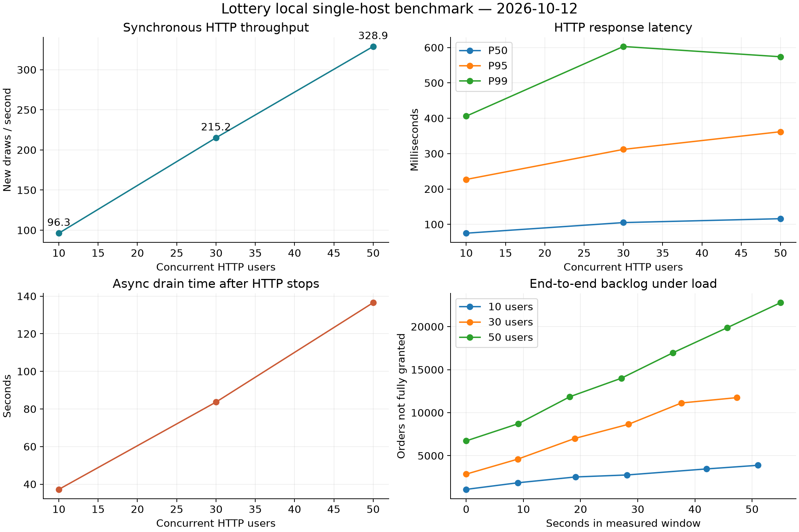
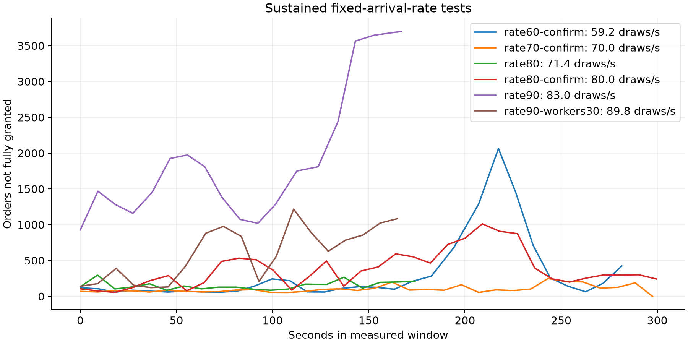

# Lottery 本地真实链路性能压测报告

日期：2026-10-12（Asia/Shanghai）。所有指标来自本次执行，已入库的汇总证据见 [结果索引](results/20261012-final/README.md)，完整原始数据保留在本地同名结果目录及压缩包。复现命令见 [README.md](README.md)，稳定性规则见 [stability.md](stability.md)。本报告描述本地单机环境，不代表生产容量。

## 测试对象与边界

实际请求 `POST /api/v1/draw`，字段为 `userId/activityId/requestId`。抽奖使用真实 ActivityProcessImpl、Redis活动/奖品预扣及用户锁、MySQL参与与订单事务、两库八订单分表、StrategySnapshot两级缓存、Outbox、Kafka结算与本地模拟发奖。每次独立操作使用新用户与新请求号，按 takeId/orderId 核对数据库事实，幂等回放不计新抽奖。

XXL-Job三个业务handler没有被Mock；启动用生产生命周期服务，库存Outbox与发奖补偿handler由测试启动器每轮结束后一秒再次调用，并传入`1,2`。真实Kafka消费者持续运行。未连接XXL-Job admin，因此未验证其调度、HA、漏调与调度中心性能。发奖为项目已有模拟渠道，不能据此宣称外部发奖恰好一次。

历史 `lottery-draw-pressure-test.jmx` 请求网关旧路径、使用uId且没有requestId；旧seed同时写两库同用户、直接DOING，没有当前启动预热。仅复用其HTTP连接与请求配置骨架，另建当前契约计划，没有执行历史SQL。当前空实例从基线提取CREATE TABLE，再执行库存Outbox、V2账本、V3归属迁移。

## 环境与运行方法

- Apple M4，10逻辑CPU，16 GiB物理内存；macOS宿主机运行应用与JMeter。
- 应用及JMeter使用Microsoft OpenJDK 17.0.18；Maven 3.9.14使用Homebrew JDK 25.0.2，项目编译Java 8目标字节码。Spring Boot 2.3.5、Kafka客户端2.5.1；JMeter 5.6.3独立JVM。
- 应用`-Xms512m -Xmx1024m -XX:ActiveProcessorCount=4`；处理器数是JVM调度配置，宿主进程没有硬CPU配额。JMeter为256/512 MiB堆、2个可用处理器。
- Docker Desktop 29.3.1，Linux aarch64 VM，10CPU、约7.65 GiB内存。MySQL 8.0.46：2CPU/2GiB；Redis7.2.16：1CPU/256MiB；Kafka2.8.1：2CPU/1GiB；ZooKeeper3.8.7：0.5CPU/384MiB。Kafka使用amd64仿真镜像、单broker、单副本、acks=1。
- 三个Hikari池各最大48、最小12、获取连接超时5秒；两个分库和全局库都在同一MySQL进程，分片没有增加数据库服务器数量。Tomcat默认最大200线程。
- MySQL默认128 MiB buffer pool，REPEATABLE READ，`innodb_flush_log_at_trx_commit=1`、binlog开启、`sync_binlog=1`。保持持久化配置，不通过关闭日志美化吞吐。
- 原有五个测试容器保留运行。资源原始记录包含这些背景进程；本机、应用、JMeter、中间件共享CPU、磁盘与Docker VM，不能把数据外推为独占硬件结果。

每轮正常基准初始化10万用户，每用户10次机会；采用生产IDBRouterStrategy把每个用户只放入其正确分库，并记录八个路由桶。独立活动100万库存，五种20%概率模拟券，每种100万库存，合计100%中奖以覆盖订单及异步主链路。创建聚合后通过PASS→DOING的生产行锁事务SETNX预热库存，不直接把数据库设为运行中。

无等待阶梯为5秒爬升、15秒预热、60秒测量。各轮资源配置、概率、用户语义与采样口径相同，上轮异步全部归零才开下一轮。活动与用户ID独立；已完成订单和配置保留，数据库体量随顺序运行增加，JIT/页缓存及背景负载也可能变化，曲线用于描述本轮测量，不能仅凭曲线将全部差异归因于并发数。没有做独占环境、多次随机顺序或统计置信区间验证。

按JTL请求完成时间进入窗口统计实际完成RPS，最近秩计算P50/P95/P99。0000表示同步下单成功，D001为完成未中奖；D004/D006/D007分别为售罄/处理中/已有未完成请求，单列预期业务拒绝。HTTP 200与业务成功分别统计。异步完成时间来自订单最后更新时间，数据库datetime仅有秒精度，因此延迟提供1秒宽的上下界。

资源约3秒采样一次，MySQL/Redis/Kafka/积压约9秒一次，实际间隔可因采集变慢而延长。Hikari获取耗时为原生回调累计增量均值；SQL digest覆盖整轮及排空阶段，累计等待是多个线程的总和，不能直接当墙钟耗时。Tomcat忙线程包含当前指标请求。采样本身有少量开销。

## 已知正确性与可观测边界

`StrategyDetailVO.awardCount`是Integer，PO是String，BeanUtils跳过该字段，实际创建的`award_count`为NULL；`award_surplus_count`正确从fixture初始化。报告保留这一真实缺陷，对账用初始化剩余库存与明确fixture数量，未补写生产列掩盖问题。建议独立修复VO→PO字段类型及创建测试。

活动MySQL `stock_surplus_count`没有在运行期参与链路扣减，保留初始值；活动消耗通过Redis余量与持久参与记录核对。奖品库存由账本事务最终扣减到MySQL。不能把活动MySQL字段宣称为实时剩余库存，也不能将该差异误认为奖品未结算。

未直接获得：Tomcat内部接受/请求队列长度、连接等待P95/P99、每条Redis命令的客户端网络延迟、策略L1/L2命中率、Kafka broker每请求延迟、外部渠道发奖效果。CPU/Heap/GC、池占用/平均获取耗时、MySQL行锁与慢SQL、Redis INFO/延迟事件、Kafka提交位点/Lag及业务积压均有原始采样。

## 执行异常与排除数据

环境准备中修复了测试启动器连接池名称初始化时机、控制器参数名，以及Spring启动失败后遗留消费者抢占分区的问题。受影响冒烟保留在 `results/20261012/` 与 `results/setup-diagnostics/`，身份确认后重建专用栈，正式数据从干净环境开始。

第一次计划50线程时，零速率ConstantThroughputTimer使实际有效线程为49；这轮`c50`保留诊断并排除正式曲线。修复为无等待/定速两份JMX，`c50-confirm`完整50线程复核。初次定速80目标实际71.4RPS，保存为速率校准结果；后续使用单调时钟绝对时隙，并增加可等待的压测线程，按实际完成速率判断，未将配置速率冒充实测速率。热点脚本首次因http包与控制函数同名而在发送请求前失败，随后新活动完整执行。空分片SUM返回NULL导致审计器报错，已在SQL聚合处用COALESCE明确表达零，原始HTTP结果和修复前审计仍保留；重新审计通过。未对正常基准混入Kafka停机或其它故障注入。

## 正常抽奖并发阶梯（真实执行）

| 并发 | 新抽奖RPS | 平均/P50 ms | P95/P99 ms | 最大 ms | HTTP/系统错误率 | 全轮新订单 | 入口停止库存/发奖未完成 | 排空秒 | 异步P95范围 ms |
|---:|---:|---:|---:|---:|---:|---:|---:|---:|---:|
| 10 | 96.3 | 102.4/75 | 227/406 | 3189 | 0%/0% | 7,233 | 2,917/4,009 | 37.2 | 50,882–51,882 |
| 30 | 215.2 | 137.6/105 | 312/603 | 1633 | 0%/0% | 15,228 | 10,792/11,954 | 83.7 | 90,332–91,332 |
| 50 | 328.9 | 150.1/116 | 362/574 | 1433 | 0%/0% | 26,368 | 21,323/23,035 | 136.5 | 133,377–134,377 |

三轮稳定窗口业务码全部为0000。全轮新操作数包含爬升/预热，请勿用该数量除以60秒冒充稳定窗口RPS。正式阶梯共48,829条新订单，每条均与参与和账本关联匹配。最终参与未消费、重复订单/重复take订单、重复账本、负库存、BLOCKED、库存未完成、发奖未完成和Kafka Lag均为0。

50并发入口短时均值328.9RPS不满足完整链路稳定规则：未完成订单线性积累，HTTP返回后的异步P95超过133秒。按需求停止继续100/200并发，未声称找到HTTP入口极限。

## 资源证据

| 并发 | 应用CPU均值（单核100%） | Heap采样峰值 MiB | 测量窗口GC时间 ms | MySQL CPU均值 | Redis CPU均值 | Kafka CPU均值 | MySQL最大连接/运行 | 行锁等待次数/累计ms |
|---:|---:|---:|---:|---:|---:|---:|---:|---:|
| 10 | 98.0% | 340.3 | 189 | 151.4% | 10.0% | 141.1% | 57/16 | 7,414/114,861 |
| 30 | 93.5% | 347.5 | 240 | 212.1% | 12.5% | 111.8% | 87/34 | 35,683/601,514 |
| 50 | 101.6% | 375.3 | 200 | 215.9% | 9.1% | 91.3% | 111/50 | 62,790/1,102,457 |

CPU以单核100%表示。Docker瞬时读数存在采样波动；MySQL cgroup实际为`200000/100000`的2核配额，且有真实nr_throttled/throttled_usec，不能将超过200%的显示值解释为额外核数。行锁累计时间来自多个并发事务，不能当作实际墙钟时长。

50并发时，用户池活跃连接峰值28/41，全局池4，均低于48；等待线程峰值0、连接获取超时0，三个池的平均获取耗时约0.022/0.011/0.003ms。Tomcat忙线程采样峰值51（含指标请求），低于200。应用GC累计200ms，占所采样稳定时间约0.34%，没有旧代收集增量。没有证据把这轮主要瓶颈归因于Hikari或GC。

Redis CPU峰值与命令执行时间记录在resources.jsonl；本轮低利用率不足以证明网络往返开销为零，但没有发现Redis服务端饱和。Kafka为x86仿真broker，存在CPU/仿真开销和消费积压，环境限制不可忽略。

## 瓶颈诊断：证据、推断与建议

**已测事实：数据库事务与锁等待是突出成本，完整链路处理速度低于过载时入口产生速度。** 50并发时MySQL接近2核配额，测量区间增加62,790次InnoDB行锁等待、累计约1,102秒并发等待。完整轮次（含排空）的SQL digest显示：lottery_02的initializeCount调用13,140次，平均104.51ms；lottery_01对应平均22.80ms。两用户库COMMIT均值约12.50/12.81ms，全局库约5.76ms。每个新操作至少有参与事务、订单事务、库存账本事务，随后还有多次状态写入，吞吐不只由随机采样或Redis决定。

`SUM_LOCK_TIME`是语句级锁计时，不能直接解释成某条用户行的全部InnoDB等待；真正的行锁增量来自Global Status。30并发的data_lock_waits现场有26条等待关系。由于当时未同时保存对应data_locks明细，不能仅凭这些关系锁定具体索引或断言跨用户阻塞原因。各分库initializeCount延迟明显不对称，需要在优化任务中联查事务、锁索引/锁数据和SQL，而不是预设同一用户热点导致所有等待。

**已测事实：库存UPDATE缺少有效条件索引。** EXPLAIN显示strategy_detail按PRIMARY扫描（当时约30行），表仅有主键，没有(strategy_id,award_id)组合索引。四个库存消费者使用UPDATE条件扣减；更大策略表下的扫描与锁范围风险有明确SQL依据。本次小表数据不足以把所有锁时间都归因于这条UPDATE。建议独立任务补充合理组合索引，并在相同数据/并发/持久化条件下做前后对照；当前报告不声称已经获得优化收益。

**已测事实：异步积压既包括Kafka消息，也包括尚未发送的Outbox义务。** 50并发入口结束时，库存未完成21,323、发奖未完成23,035；即时stock Lag约1,097、invoice Lag约1,465。不能只看Kafka Lag便宣称异步健康。测量阶段库存/发奖已提交消息速率约61.9/43.2条每秒，显著低于328.9条新订单每秒；消息速率包含重复投递，独立业务完成仍以账本/订单为准。

**源码事实与推断：** Outbox以单个handler顺序扫描八分表，每条还执行已完成查询、Redis claim、Kafka发送及状态回调；默认每表200条。一轮handler越慢，固定延迟后的下一轮越晚。全局库存事务、发奖更新与同步参与/订单事务共享同一个受限MySQL，数据库CPU/锁/持久化等待与顺序投递共同限制端到端吞吐。线程dump捕获到消费者处于结算事务及handler逐条投递路径，但单次栈不是耗时百分比分析；没有CPU火焰图或生产规模A/B，因此不把某一方法宣称为唯一根因。

建议按证据顺序做后续优化：先修复总库存字段映射；针对initializeCount与库存UPDATE采集完整锁明细及执行计划；评估无变化INSERT ON DUPLICATE的必要性与事务持锁范围；补充库存组合索引；再测按分库调度、批量投递和状态写入成本。保留参与/订单/账本幂等约束与持久化语义，不能用删唯一键、放松提交持久性或盲目增加池/线程掩盖成本。

Redis存在少量慢命令事件，原始SLOWLOG与LATENCY保存，服务端平均执行时间与客户端网络延迟是不同指标。Kafka仿真开销及本机共享资源也参与测量限制。以上建议均未实施，未大规模改动生产代码，也没有未经验证的“优化后提升倍数”。

## 热点用户、幂等与库存竞争（真实执行）

| 场景 | HTTP/业务结果 | 持久化事实 |
|---|---|---|
| 同用户50个不同requestId并发 | 1次0000、49次D006 | 1次机会消耗、1个take、1个order、1条账本 |
| 同用户同requestId并发50次 | 1次0000、49次D006；随后重放仍返回原奖品/参与/订单 | 原请求只有1次机会消耗和1套记录 |
| 请求体已发送，客户端读取1ms超时 | 实际观察socket timeout，原ID继续请求，可能先D006后0000 | timeout-user仅1个take/order/账本；再次重放ID不变 |
| 同用户有合法未完成take，再发新ID | D007携带pendingRequestId，原ID完成 | 新ID不创建take；原take只消费一次 |
| 活动库存100，50线程竞争 | 40,202次请求：100次0000、40,102次D004 | 活动Redis为0；次数/take/order/账本均100；奖品按订单数扣减 |
| 五奖品各10，活动库存100,000，30线程竞争 | 8,404次请求：50次0000、8,354次D001 | take/扣次8,404，中奖order/账本50；各奖品Redis/MySQL均0 |

D006/D007/D004属于预期拒绝，D001为完成的未中奖，均没有被算成系统故障。活动售罄请求的约2,680RPS是快速拒绝吞吐；奖品售罄后的约560RPS主要是未中奖路径，均不能替代正常中奖订单主链路的容量数据。

最终没有负库存、重复order/take订单、重复账本、未消费take或BLOCKED；库存消息/发奖消息/本地grant均收口，两个Kafka组八分区Lag归零。自然Outbox重投可能产生更多Kafka消息，账本唯一约束和最终订单关联确保同一订单只形成一次库存消耗。第三方发奖未接入，结论止于本地模拟发奖状态。

## 持续吞吐与最大稳定容量结论

**本环境未测得满足全部预设条件的最大稳定吞吐，不能给出一个“稳定QPS”作为最终容量。** 60/70/80/90的测试均真实执行，以下数据按实际完成量计算，失败标准没有事后放宽。

| 测试 | 目标/实际新抽奖RPS | 测量秒 | P95/P99 ms | 积压峰值 | 首尾平均积压增长 | 异步P95范围 ms | 排空秒 | 稳定性判定 |
|---|---:|---:|---:|---:|---:|---:|---:|---|
| rate80 | 80/71.44 | 180 | 194/402 | 295 | 36.9 | 3,500–4,500 | 0.6 | 未通过 |
| rate90 | 90/82.95 | 180 | 276/711 | 3700 | 1363.5 | 79,807–80,807 | 66.2 | 未通过 |
| rate90-workers30 | 90/89.79 | 180 | 285/688 | 1218 | 707.7 | 18,107–19,107 | 18.2 | 未通过 |
| rate80-confirm | 80/79.96 | 300 | 261/696 | 1012 | 128.7 | 10,930–11,930 | 5.1 | 未通过 |
| rate70-confirm | 70/69.97 | 300 | 139/496 | 248 | 83.7 | 2,937–3,937 | 0.3 | 未通过 |
| rate60-confirm | 60/59.17 | 300 | 531/1662 | 2065 | 379.7 | 20,852–21,852 | 9.0 | 未通过 |

`rate80`是旧定速器校准：实际71.44RPS的180秒窗口，积压峰值295、末端增长36.9、异步P95上界4.5秒，结束约0.6秒收敛；它没有达到80配置目标，也没有完成300秒复核，因此只能作为一个观测点，不能宣称最大稳定容量。

70RPS复核实际69.97RPS、300秒，积压峰值248，其他链路条件通过；首尾平均积压增加83.7条，略高于预设的一秒请求量阈值，因此保守判定未通过。这个边界不代表70RPS会立即雪崩，只说明按本次固定标准不能给它稳定容量认证。80RPS则积压峰值1,012、增长128.7且异步P95越过10秒，90RPS的积压增长更明显。

60RPS复核后段出现约5.9秒单请求延迟和超过2,000条积压，低速反而波动，说明本机共享环境不能产生单调、可归因的稳定容量曲线。现场宿主机swap使用约11.9GiB；停止施压后15.126秒内仍有3,590页swap-in、7,096页swap-out，每页16KiB，约56.1/110.9MiB主动换入/换出。换页计数与原始vm_stat摘录见[host-memory-summary.json](results/20261012-final/host-memory-summary.json)；包含进程列表的原始`host-memory-pressure.jsonl`保留本地。这证明存在活跃换页，可能参与延迟波动；由于没有起始阶段同口径换页采样或独占环境对照，不能断言所有延迟均由swap造成。

在此限制下停止继续更低速率的盲目试探。最大稳定容量需要在内存充足、可控背景负载的机器上，用同一套脚本重新测量；不擅自关闭用户原有应用或测试实例。已测入口328.9RPS、低负载71.44RPS观测点与稳定性未通过结论分别保留，不能合并成“系统稳定支持329QPS”。

## 全局业务审计与质量验证

整个干净压测实例最终有185,754个唯一订单、185,754条唯一账本；每个订单的take唯一，库存消息/发奖消息/本地grant未完成数和BLOCKED均0，无负奖品库存。发奖日志中185,754次本地handler调用对应185,754个订单，未发现同一订单重复调用。Kafka累计库存/发奖提交位点为187,232/186,302，高于订单数反映at-least-once重放，最终Lag均0。该全局数包含冒烟及被排除的49线程轮次；正式正常阶梯与定速测试单独合计164,868个新中奖订单，不混用数量。

`mvn -q test`本轮34个默认单元测试全部通过，0失败/0错误；旧ManualIT报告按文件时间排除，没有冒充本轮执行。运行时class path构建与Java启动器编译通过，Python编译、shell语法和Compose配置检查通过。无效49/计划50轮次被分析器正确拒绝；正常、有限库存与幂等的全量ID/库存/账本断言通过。生产业务代码和原有测试未修改。

专用应用和lottery-perf四个容器已停止，数据库容器与原始文件保留；原有五个容器仍运行。清理命令只针对经过标签与端口确认的专用项目。

## 可用于简历与面试的真实描述

可用简历条目：

> 搭建JMeter与独立Docker真实链路压测，覆盖Redis库存预扣、MySQL两库八订单分表、Outbox/Kafka结算和本地模拟发奖；本地50并发、60秒窗口测得328.9次新抽奖/秒，P95/P99为362/574ms，验证16.49万条正常中奖订单与参与/库存账本一致，定位数据库事务锁等待及异步积压瓶颈。

面试补充：

> 329RPS是本机短时HTTP下单吞吐，停止后异步清空约137秒；持续60/70/80/90RPS分别实测，没有找到通过全部预设条件的稳定容量。后段宿主机存在约11.9GiB swap及活跃换页，因此不能把数据外推生产，也不能据此声称已经优化了多少倍。发奖仍是项目现有本地模拟渠道。

不宜写“生产稳定329QPS”“性能提升X倍”“Kafka端到端无积压”“第三方发奖恰好一次”。这些都缺少本轮证据。
