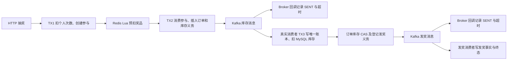

# Lottery V8 订单发送回写合批实验

## 范围与初始状态

双路径和仅库存成功回写合批均未得到可复现的持续吞吐提升，保留原逐单回写。迟到回调在终态时影响 0 行，成功回调早到时仍需持久化 SENT 和消费超时。合批可以减少数据库写事务，但发奖合批扩大了与终态 CAS 的行锁竞争，库存合批两轮也未通过积压门槛。原版在本次后段环境中最高重复通过 150 RPS（两轮各约 190 秒），220 RPS 仅单轮通过。

在 `codex/activity-prize-pool` 上以 `af015a5` 为原版。任务开始时有 16 个受版本控制的压测工具修改和 1 个未跟踪的 V8 诊断脚本，均与正式业务源码区分保存。历史记录只读，压测使用原 `lottery-v8-throughput` 数据卷与新活动 ID。原业务源码和原始工具快照在相同 Java 8 版本编译，使用同一 Java 17 运行时。正式 A、B 类目录的逐文件比较只发现本实验的五个生产文件及相应内部类差异。

参考[历史容量报告](results/v8-capacity-refine-20261114/REMOTE_CAPACITY_REPORT.md)和[历史优化报告](results/v8-opt-20261114/REMOTE_OPTIMIZATION_REPORT.md)。原始 JTL、SQL、资源记录、故障日志和运行参数保存在本地 [v8-outbox-write-20261114](results/v8-outbox-write-20261114/)。

## 每单数据库写入

- **TX1**。参与仓储按用户和活动扣 `left_count>0` 的个人额度并插入参与记录。业务事务提交后进行 Redis 奖品条件预扣。压测用户已预置额度，无须为每个请求插入额度行。
- **TX2**。`OrderRepository.saveDrawOrderWithTakeLock` 按用户、活动、参与号及未消费状态更新参与；订单 INSERT 保存奖品快照以及库存 `INIT`、首发代数 1、两秒到期。事务内发布事件，只有真实提交后 `OutboxDispatcher.afterOrderCommit` 才安排投递。丢失订单 INSERT 或事务绑定会破坏订单与投递义务原子性。
- **库存发送结果**。`OutboxDispatcher → OrderRepository.finishOutbox → DrawOrder_Mapper.xml` 以 `order_id`、`stock_attempt` 和库存状态 `IN (0,2,3)` 定位。成功写 `stock_settlement_event_status=3` 和 `stock_retry_at=落库时间+600s`。失败写 FAIL 或保留 SENT 并设置按代数退避的截止时间。删掉先到的成功回写会让 Broker 已确认、消费仍积压的订单继续沿两秒首发期限进入补偿，增加重复投递并改变消费超时契约。
- **TX3**。`StockSettlementListener` 按用户和订单读取权威快照。已完成或 BLOCKED 消息直接确认。未完成订单在同一个事务内插入 `award_stock_settlement`（订单唯一），按 `activity_id+award_id+award_surplus_count>0` 扣 MySQL 奖品库存。账本重复时不再扣库存；条件扣减失败回滚账本并以独立 CAS 写库存 BLOCKED、清空重试时间。SQL 异常向上抛出。
- **库存完成 CAS**。`StockSettlementListener → updateStockSettlementEventStatus` 按用户、订单号、库存状态 `IN (0,2,3)` 写 COMPLETE、`stock_settled_at`、`update_time`，清空库存重试时间。发奖尚未完成时同时递增 `fulfillment_attempt` 并保存发奖首发期限。只有 CAS 胜出者发起实时发奖。库存 ACK 晚于该状态推进。删掉会丢失发奖义务，若先 ACK 会扩大恢复窗口。
- **发奖发送结果**。`OutboxDispatcher → finishOutbox` 检查 `order_id`、`fulfillment_attempt`、消息状态 `IN (0,2,3)`、库存 COMPLETE、发奖事实未完成。成功写 `fulfillment_event_status=3` 和消费超时；失败保留原退避语义。删除早到的回调同样会提前启动补偿。
- **发奖完成 CAS**。`AwardFulfillmentListener → AwardFulfillmentHandler → markUserAwardGranted` 按用户、订单、奖品、库存 COMPLETE 和发奖事实未完成，写真实（本地模拟）发奖完成、`fulfilled_at`、事件 COMPLETE、清空发奖期限并更新时间。零行时仓储核对已发奖事实。已完成重复消费正常跳过写入，历史已发奖而消息状态尚未收口时才单独修复。发奖 ACK 晚于事实持久化。
- **补偿**。两个调度任务按各自 `retry_at` 索引取到期非终态订单，`claimOutbox` 按订单、代数、阶段条件和到期时间 CAS，递增代数并写 45 秒租期。只有领取成功才发送。旧代数结果无法覆盖新租期；两种终态消费均会清空当前阶段补偿时间。

成功主链路每单有 TX1、TX2、TX3 三个显式事务，以及四条典型 `draw_order` 自动提交 UPDATE。显式 `COMMIT` 摘要只覆盖前者和少量其他显式事务。回调/CAS 在同一订单行的唯一键上竞争；库存扣减在同活动奖品行竞争。扫描、补偿领取、重复消息与历史修复数量随负载变化。

## 历史数据复核

从各目录的 `sql-before.tsv`、`sql-after.tsv` 相减。每格是执行数 / 影响行数，含预热与排空。快照来自实例级摘要，发生在途提交及读取非原子计数时存在边界偏差。Connector/J 的受影响行返回口径也应和 MySQL 实际数据变更区分。表中差值只用于估算规模，具体终态零行数由独立用例验证。

| 原始窗口 | 库存发送回写 | 库存完成 CAS | 发奖发送回写 | 发奖完成 CAS | 显式 COMMIT |
|---|---:|---:|---:|---:|---:|
| 容量 215 | 44,056 / 44,041 | 44,054 / 44,042 | 44,045 / 43,847 | 44,044 / 44,055 | 131,891 |
| 容量 220 | 45,041 / 44,969 | 45,057 / 45,042 | 45,057 / 43,812 | 45,074 / 45,063 | 134,759 |
| 容量 225 | 45,989 / 45,839 | 46,060 / 46,032 | 46,037 / 42,221 | 46,031 / 46,027 | 137,612 |
| 优化报告基线 220 | 45,060 / 45,010 | 45,068 / 45,051 | 45,058 / 44,479 | 45,064 / 45,061 | 134,825 |

220 RPS 的优化报告基线中，库存和发奖回写分别有 50 和 579 次执行与影响行数之差。这个差值混合了终态、代数失效和采样边界。单笔测试确认消费者先提交 COMPLETE 后，迟到的成功回调仍向 MySQL 发 UPDATE，WHERE 不通过，影响 0 行，重试字段保持 NULL。阻止状态回退的是数据库 CAS。可见的无效语句只占成功主链路的一小部分。

原边界 215→220→225 的 MySQL 显式 COMMIT 均值为 2.21→6.36→16.11 ms，TX3 的 JDBC COMMIT P99 桶上界为 8.192→32.768→131.072 ms；全局 InnoDB 锁等待时间在同窗累计 63.6→104.4→174.8 秒。锁快照分别命中 `draw_order.uk_order_id` 33→37→61 条，`activity_prize.uk_activity_award` 2→8→26 条。等待采样可能重复观察同一等待。多条阻塞边指向 `waiting for handler commit`，说明提交期间行锁仍在持有。当前数据无法区分磁盘、Binlog、InnoDB 与宿主排队对最初拐点各自的贡献。

## 候选与首轮选择

| 候选 | 预期收益 | 一致性或复杂度判断 |
|---|---|---|
| 回调前做一次 SELECT 或用本机终态提示短路 | 回避部分 0 行 UPDATE | 220 基线占比很小；普遍 SELECT 会增加一次往返，本机提示还需覆盖跨进程、迟到和驱逐。未选。 |
| 去掉所有成功回写，直接依赖消费者收口 | 接近每单少两次成功 SQL | Broker ACK 与实际消费有独立语义。积压时每个已确认订单会提前参与补偿，丢失 600 秒持久期限。排除。 |
| 消费者事务合并、调线程/Hikari/Binlog | 可能改变提交成本或调度 | 历史实验已经覆盖，保持已有结论。 |
| 同事件类型的成功结果合批 | 保留实际更新和谓词，多个自动提交合为一个，避免每笔都排一个结果任务 | 批内持有多个行锁，可能产生更长竞争或更多受单条 SQL 失败影响的订单。需要验证失败恢复和长期负载。首轮只验证此项。 |

B 把成功通知交给两个按事件类型独立的短队列。已有 128 个在途许可继续限制全部待发送和待持久化结果，同类最多一个批量写任务在执行；其执行期间自然形成下一批，无固定等待窗口。Mapper 用 `(order_id, attempt) IN (...)` 和原 `canDispatch` 判定每一对，用一条自动提交 UPDATE 写 SENT 和消费超时。MySQL 8.0.46 的 `EXPLAIN UPDATE` 对三个元组使用 `uk_order_id` 范围访问、估计三行。失败通知仍单条写退避。变更只涉及 `OutboxDispatcher.java`、`IOrderRepository.java`、`OrderRepository.java`、`IDrawOrderDao.java` 和 `DrawOrder_Mapper.xml`。

早到回调仍保存 SENT 与期限；迟到回调在数据库中按代数和终态过滤；重复元组在同批只命中一行，分属不同批次沿用同代数重复 SENT 刷新期限的原条件。若批内 SQL 异常，整批回滚、日志包含事件类型和订单号，数据库保留原重试时间与代数。进程在批写入前退出与原实现丢失回调等价。进程在批提交后退出仍有 600 秒重试期限或消费者已提交的终态。该排队只整理已有回调，重启依据仍是持久订单。

## 功能和故障验证

| 运行 | 用例和结果 |
|---|---|
| A 原实现 | Java 8 定向 51 项通过（Kafka E2E 11、HTTP E2E 29、消息单元测试 11）。 |
| B 默认构建 | Java 8 `mvn -B package`，54 项通过。 |
| B 真实中间件 | V8 独立 MySQL、Redis、Kafka，Kafka E2E 13 项、HTTP E2E 29 项共 42 项通过。|
| B 定向单元 | 12 项通过，含三笔同类回调形成两个批次、在途许可维持上限。 |
| B 并发补测 | 独立真实 MySQL 上两个线程竞争同一批订单的回写与库存 CAS，随后走真实 Kafka 发奖，1 项通过。 |

A 与 B 的共同用例验证正常 ACK、消费先完成/发送确认先到、Kafka 和业务重复事件、Broker 停机、迟到失败通知、回调丢失、持久租期到期、外层事务回滚、库存分歧 BLOCKED、TX3 已提交但订单 CAS 被真实数据库触发器拒绝，随后真实 Kafka 重放原订单。B 另测混合代数和终态的批量影响行数，以及多行批更新中的一行 SQL 失败导致整条语句回滚、调度恢复。对发奖验证真实 Kafka 重复消费、发奖时间不重写和迟到回调；当前发奖为数据库本地模拟。

首轮定向单元运行暴露测试仍断言旧成功仓储方法和漏计首次 Kafka 发送任务，修正测试观测后复跑通过。一次带显式 `*Test` 通配的 Maven 命令选中了默认 Maven 门禁明确排除、需要其他开发环境的旧 DAO 测试；中止该命令后按默认门禁和显式 E2E 类名分别重跑，日志完整保留。

真实进程退出使用两个新活动，由 curl 访问与 JMeter 相同的测试应用。提交前演练在 TX2 两条 SQL 执行后、真实 JDBC COMMIT 前暂停并 SIGKILL。MySQL 回滚订单和参与消费，账本为 0，Redis 有一笔孤立预扣。这个跨 Redis 与 MySQL 的缺口在项目既有记录中已知。演练记录缺口后，只对指定测试活动做人工对账、重放原请求，Redis 和 MySQL 重新对齐。

提交后演练在订单已经提交且发送任务尚未入队时 SIGKILL。重启就绪后约 1.58 秒完成库存和发奖，原 HTTP 请求重放得到同一订单，账本一行、个人额度只扣一次、两组 Lag 为 0。完整事件和逐 ID 审计见原始目录，另附 [进程演练汇总](v8-outbox-crash-results.json)。

## 压测方法

复用 JMeter 5.6.3、72 线程、15 秒预热、190 秒测量、65,000 独立用户、5 个等概率奖品、100% 中奖。每轮新活动 ID，上一轮排空且两组八分区 Lag 为 0 后再运行。应用侧 6 个 Outbox 工作线程、库存/发奖各 4 个消费者、48 个 Hikari 最大连接沿用原值。MySQL 8.0.46 使用原 2 CPU / 2 GiB，`innodb_flush_log_at_trx_commit=1`、`sync_binlog=1`、`binlog_group_commit_sync_delay=0`。复用 `check_stability.py` 全部既定门槛。

独立记录 InnoDB `trx_rw_commits`（含自动提交），以及显式 COMMIT 的语句直方图首尾桶增量。后者的分位数为桶上界，MySQL COMMIT 均值使用正式窗口内首末资源样本。全轮 SQL 和事务计数范围不同：InnoDB 计数额外包含活动预置和收尾，`sql-before.tsv` 与 `sql-after.tsv` 覆盖预热、负载及排空。单次计数可由 [MySQL 8.0.46 事务实现](https://dev.mysql.com/doc/dev/mysql-server/8.0.46/trx0trx_8cc.html) 和 [Performance Schema 直方图说明](https://dev.mysql.com/doc/refman/8.0/en/performance-schema-statement-histogram-summary-tables.html) 核对。

首轮 A（`a220-1`）在 Kafka 1 GiB 容器限制下触发 OOM（退出码 137，`OOMKilled=true`），Lag HTTP 采样中断。记录无效轮，不作为性能对照。原容器、卷和 Broker 堆保留，容器上限加至 1.5 GiB 后用于全部正式轮次。只在故障排空进程中将两个补偿调度间隔改为 100 ms，73.61 秒后清空，45,102 笔 HTTP、参与、订单、库存和账本逐项审计通过，两组位点 Lag 为 0。正式各轮使用原调度间隔，故障排空过程不计入性能。

## 正式重复 A/B

| 轮次 | 门槛 | 抽奖/s | 库存/s | 发奖/s | HTTP P95/P99 ms | 库存 P95 上界 ms | 发奖积压峰值/首尾增长 | 排空 s |
|---|---|---:|---:|---:|---:|---:|---:|---:|
| a215-1 | FAIL | 214.98 | 208.58 | 208.57 | 42/293 | 1,822 | 1,204/+185 | 59.07 |
| b215-1 | FAIL | 214.52 | 186.06 | 186.05 | 146/399 | 28,049 | 4,876/+2749 | 29.72 |
| b215-2 | PASS | 214.95 | 214.57 | 214.56 | 90/227 | 1,635 | 325/+144 | 0.64 |
| a215-2 | FAIL | 214.86 | 208.05 | 207.98 | 51/340 | 3,594 | 837/+321 | 20.34 |
| a220-2 | PASS | 219.55 | 218.85 | 218.82 | 28/72 | 253 | 179/+43 | 0.69 |
| b220-1 | FAIL | 219.55 | 194.15 | 194.14 | 154/393 | 23,537 | 4,647/+3192 | 23.07 |
| b220-2 | FAIL | 219.98 | 189.90 | 189.91 | 142/435 | 27,704 | 5,407/+3875 | 25.95 |
| a220-3 | FAIL | 220.00 | 194.79 | 194.79 | 114/383 | 22,628 | 4,323/+2312 | 61.38 |
| b225-1 | FAIL | 225.00 | 201.24 | 201.23 | 191/470 | 20,808 | 4,206/+2659 | 17.93 |
| a225-1 | FAIL | 224.98 | 206.42 | 206.42 | 55/255 | 19,182 | 3,709/+2099 | 19.75 |
| a225-2 | FAIL | 225.01 | 219.82 | 219.81 | 40/89 | 3,586 | 899/+204 | 19.02 |
| b225-2 | PASS* | 225.22 | 227.23 | 227.23 | 34/49 | 399 | 73/+3 | 0.84 |

表内 A/B 12 轮共 541,040 笔订单。加上仅库存合批复测和原版容量复核，共 22 轮、980,640 笔订单，逐轮对账全部通过。所有正式窗口 HTTP 错误率、系统错误率及 Swap-in/out 均为 0。

带星号的一轮按原规则评分为 PASS，但跨系统时间戳异常。按订单对齐后有 3,996 单创建时间晚于 HTTP 响应，最大 175 ms，11 单出现库存完成时间早于订单创建时间。保留原始评分，227.23/s 和 399 ms 不用来认证容量或延迟。该轮库存 Kafka 位点速率为 224.21/s，采样期间积压接近持平，停压后 0.84 秒排空。

### 提交、锁和消费观测

| 轮次 | MySQL COMMIT 均值/P95/P99 ms | TX3 COMMIT P99 ms | 锁采样 订单/奖池 | 全轮锁等待 s | Hikari 活跃/等待 | Kafka Lag 峰值 库存/发奖 | Kafka 位点/s 库存/发奖 |
|---|---:|---:|---:|---:|---:|---:|---:|
| a215-1 | 4.74/8.32/39.81 | 16.38 | 28/8 | 132.75 | 48/34 | 641/4 | 208.48/208.45 |
| b215-1 | 8.50/26.30/109.65 | 65.54 | 32/9 | 165.13 | 48/34 | 5,048/5 | 186.84/186.83 |
| b215-2 | 5.82/13.80/83.18 | 32.77 | 24/4 | 124.50 | 48/7 | 323/5 | 212.92/212.93 |
| a215-2 | 4.98/9.12/75.86 | 16.38 | 23/3 | 100.86 | 48/37 | 683/4 | 209.64/209.61 |
| a220-2 | 3.45/6.31/12.59 | 16.38 | 31/2 | 107.77 | 21/0 | 136/18 | 216.92/216.82 |
| b220-1 | 9.09/27.54/109.65 | 32.77 | 40/2 | 166.27 | 48/32 | 4,543/4 | 192.15/192.16 |
| b220-2 | 9.57/—/— | 32.77 | 42/12 | 168.32 | 48/34 | 5,430/5 | 189.37/189.35 |
| a220-3 | 7.69/19.95/87.10 | 32.77 | 29/7 | 173.61 | 48/34 | 3,717/4 | 195.47/195.36 |
| b225-1 | 8.67/23.99/120.23 | 32.77 | 35/9 | 153.83 | 48/32 | 4,218/4 | 201.29/201.30 |
| a225-1 | 6.43/12.02/52.48 | 32.77 | 38/9 | 191.15 | 48/34 | 3,606/13 | 204.71/204.71 |
| a225-2 | 4.19/9.12/27.54 | 32.77 | 36/6 | 151.25 | 31/0 | 942/4 | 218.82/218.80 |
| b225-2 | 3.54/6.61/12.59 | 16.38 | 34/5 | 119.23 | 31/0 | 93/5 | 224.21/224.21 |

全轮锁时长来自 InnoDB 计数增量，表级等待数是测量窗口内的样本命中次数。COMMIT P95/P99 为全轮服务端直方图桶上界，均值为资源同窗统计，TX3 P99 为 JDBC 桶上界。

### SQL 次数、影响行数和事务数

| 轮次 | 库存发送回写次数/行数 | 发奖发送回写次数/行数 | 库存 CAS 次数/行数 | 发奖 CAS 次数/行数 | 显式 COMMIT | InnoDB 读写事务 |
|---|---:|---:|---:|---:|---:|---:|
| a215-1 | 43,964/43,912 | 43,975/43,321 | 43,981/43,976 | 43,958/43,967 | 131,211 | 309,121 |
| b215-1 | 29,520/44,007 | 35,833/27,638 | 43,885/43,849 | 43,888/43,850 | 130,809 | 285,439 |
| b215-2 | 33,584/44,064 | 36,975/28,798 | 44,000/43,980 | 43,969/43,948 | 131,366 | 290,925 |
| a215-2 | 44,007/43,957 | 44,009/43,156 | 44,014/43,995 | 44,007/44,002 | 131,678 | 308,837 |
| a220-2 | 44,959/44,911 | 44,956/44,474 | 44,955/44,945 | 44,968/44,971 | 134,205 | 315,489 |
| b220-1 | 31,907/45,017 | 36,634/27,592 | 44,891/44,864 | 44,910/44,868 | 133,888 | 293,678 |
| b220-2 | 31,393/45,103 | 36,626/27,915 | 44,990/44,990 | 44,962/44,959 | 134,068 | — |
| a220-3 | 44,940/44,856 | 44,962/43,415 | 44,966/44,944 | 44,963/44,961 | 134,057 | 316,622 |
| b225-1 | 32,115/46,129 | 37,357/28,057 | 46,037/45,991 | 46,012/45,994 | 137,205 | 300,157 |
| a225-1 | 45,972/45,939 | 45,958/44,846 | 46,000/45,966 | 45,968/45,978 | 137,049 | 323,343 |
| a225-2 | 46,005/45,958 | 46,012/45,398 | 46,010/45,989 | 45,998/46,000 | 137,183 | 323,034 |
| b225-2 | 37,060/46,169 | 38,091/28,895 | 46,055/46,033 | 45,997/46,014 | 137,315 | 306,044 |

更多可机读数据见 [v8-outbox-write-results.json](v8-outbox-write-results.json)。

### 第一个 220 RPS 配对的诊断

A 与 B 的实际抽奖速率均约 219.55/s。B 两种发送回写 SQL 共 68,541 次，A 共 89,915 次，少 23.8%。全轮 InnoDB 读写提交由 315,489 降至 293,678（少 6.9%），显式 COMMIT 的数量基本相同。B 的库存结算由 218.85/s 降至 194.15/s，库存 P95 上界从 253 ms 升到 23,537 ms，排空从 0.69 s 延长到 23.07 s。B 零发送失败、零补偿领取和零排队拒绝，业务滞后主要位于库存 Kafka 消费及其数据库处理链路。截至 HTTP 停止，库存待结算 4,450 单，库存组 Lag 4,369。

B 的 MySQL 显式 COMMIT 均值 9.09 ms、P99 桶上界 109.65 ms，A 为 3.45 ms、12.59 ms。全轮 InnoDB 锁等待时间从 107.77 增至 166.27 秒，Hikari 活跃/等待峰值由 21/0 增至 48/32。B 的锁快照中 27 次发奖完成 CAS 等待发奖批量回写提交，9 次发奖批量回写反过来等待发奖完成 CAS 提交。A 中 25 次发奖完成 CAS 等待单笔发奖回写提交。一个多行事务可在等待其他订单时继续持有已锁定的行，提交越慢，受影响订单越多。B 的发奖回写影响 27,592 行，明显低于 A 的 44,474 行。数据库谓词已把 B 较迟到达落库的回调挡在终态外。这同时说明减少回写的行数和事务数不足以预测持续吞吐，仍需看提交耗时、积压及轮间重复结果。

换序后的 `b220-2` 同样发生失稳。发奖完成 CAS 等批量回写提交 30 次，批量回写等发奖 CAS 提交 10 次。该轮在 JMeter、排空、SQL 及业务审计完成后遇到试验脚本文件热改导致 Bash 解析失败，独立 InnoDB 提交与服务端 COMMIT 直方图缺结束快照。稳定性与同窗诊断从已保存的原始数据重算，空缺的指标记录为缺失。

同组换序的 A（`a220-3`）也失稳，库存 194.79/s。此时入口结束后用 61.38 秒排空，慢于 B 的 25.95 秒。A 触发 865 次工作池拒绝与 863 次补偿重试，停压时库存有 531 条到期义务，B 分别为 0、1、0。两轮 B 均未通过，A 仅一次通过。锁快照支持两种回写形式的竞争路径差异，环境距饱和过近，不能把每轮的绝对吞吐差值全归因于批量实现。

### 从双路径缩减到仅库存路径

B 的直接收益在三个速率上都能复现，按配对约减少 18%～26% 发送回写 SQL，能读取独立计数的配对约减少 5%～8% InnoDB 读写提交。稳定性收益没有复现，已恢复 B 的业务源码。保留能同时在原版通过的发送确认、回调丢失与库存提交后 CAS 失败用例。批量专用用例与业务差异随实验补丁保存。恢复后的 Java 8 默认构建通过 53 项，真实 MySQL、Redis、Kafka 定向回归通过 40 项。

各 B 轮的锁采样集中在发奖回写与发奖完成 CAS；库存回写受到的直接竞争少得多。下一轮将单因素缩到 C：仅合批库存成功回写，发奖成功和两种失败通知走原单行路径。C 在独立工作树构建，Java 8 默认构建 54 项通过。B 与 C 的编译产物比较仅 OutboxDispatcher 及其内部类有差异。

C 在 220 RPS 两轮分别完成库存 213.88 和 207.99 单/s。两轮停压均可在 15 秒内排空，但平均积压首尾增加 917 和 1,301 单，均超过门槛。第二轮还超出峰值积压与异步 P95 门槛。库存回写分别只执行 35,166 和 30,568 次，仍分别影响 45,087 和 45,020 行。配对 A 的库存结算为 216.39 和 198.20 单/s，C 一低一高。C 保留发奖单行更新，可以绕开 B 中的发奖批量双向锁等待。单独减少库存回写事务仍未获得持续稳定。C 源码只在隔离实验工作树出现，实验结束后保存补丁并移除该工作树。

### 原版 200 RPS 延长测量

原版恢复后再做两轮 300 秒正式测量。两轮分别为 198.33 和 185.03 库存结算/s，停压后分别用 33.52 和 101.72 秒排空，均未过稳定性。63,013 和 63,010 笔订单全部完成最终对账。两轮分别触发 1,209 和 1,276 次 Outbox 拒绝。同期 InnoDB 缓冲池物理读约 25.6 万和 26.2 万，显著高于早期 190 秒 220 RPS 窗口的 9.0 万～10.0 万，即使考虑窗口时长也更高。测试活动和旧订单保留，数据量持续增加。记录包括累计 SQL、提交与 I/O，本轮未单独改变数据量、磁盘或缓存做归因实验。

| 轮次 | 窗口 s | 通过 | 库存/s | HTTP P95/P99 ms | 库存 P95 上界 ms | 排空 s |
|---|---:|---|---:|---:|---:|---:|
| a220-4 | 190 | FAIL | 216.39 | 108/368 | 4,014 | 20.67 |
| c220-1 | 190 | FAIL | 213.88 | 165/406 | 6,076 | 6.54 |
| c220-2 | 190 | FAIL | 207.99 | 227/508 | 12,503 | 13.70 |
| a220-5 | 190 | FAIL | 198.20 | 139/282 | 19,013 | 41.59 |
| a200-1 | 300 | FAIL | 198.33 | 165/417 | 4,341 | 33.52 |
| a200-2 | 300 | FAIL | 185.03 | 155/364 | 20,548 | 101.72 |
| a175-1 | 190 | FAIL | 173.23 | 87/448 | 1,663 | 27.73 |
| a175-2 | 190 | PASS | 173.43 | 160/416 | 1,362 | 10.78 |
| a150-1 | 190 | PASS | 150.00 | 24/165 | 59 | 1.18 |
| a150-2 | 190 | PASS | 149.73 | 205/349 | 893 | 8.83 |

## 结论与后续

- 保留原版的订单 CAS、账本、ACK、补偿资格和逐单确认。此次没有证据支持删除早到回调，或者为减少少量迟到零行语句而普遍添加一次读取。两种合批均结束，继续增加并行度或放松事务保障不在本次范围。
- 220 RPS 在保留的原版出现过一次完整通过，随后三次 220 RPS 基线失稳。历史 215 RPS 单轮通过，当前两轮未复现。B 的 225 RPS 原规则通过也只有一次且存在时钟偏移。后段原版 200 RPS 两次失败、175 RPS 一次通过、150 RPS 两次通过。本次最高可重复通过的档位为 150 RPS，每轮约 190 秒。这些轮次的累积数据量不同，无法推定较长生产窗口的上限。
- 提交前 Redis 孤立预扣需要独立业务设计。当前只有人工核对，批量回写路径位于其后，不能修复该缺口。
- 若继续定位原发瓶颈，优先固定数据体量和宿主背景，将 redo、Binlog、Docker 虚拟磁盘及缓冲池物理读与提交尾延迟同窗对比。早期 220 RPS 的物理读约 494～556 次/s，后期同档为 1,015～1,067 次/s。后期运行数据量与 I/O 条件已不同。MySQL 并未持续占满 2 核，当前证据支持持久化拥塞与行锁相互放大，磁盘、组提交和数据集增长的独立贡献仍未量化。

## 复现材料

- `v8_outbox_write_trial.sh` 完成预检、启动经比对的类目录、执行现有 JMeter、补充 COMMIT 快照并调用原稳定性检查。用法为 `bash doc/performance/v8_outbox_write_trial.sh <轮次> <A|B|C> <RPS> <新活动ID> [总秒数] [用户数]`。试验脚本固定指向本机已存在的隔离栈。测量前在该实例分别为 `trx_rw_commits` 和 `trx_commits_insert_update` 设置 `innodb_monitor_enable`，全部轮次结束后按原状态禁用。
- 本地原始目录含 `existing-v8-perf-tools.patch`、`v8_stock_diagnostics.py`、`batch-experiment.patch`、`stock-only-experiment.patch` 和 `classes-A/B/C`。原工作树的压测改动按字节保留。需要在新检出复现时，先在隔离工作树使用该压测差异与诊断脚本，再分别编译原版及实验源码。实验补丁中包含批量专用回归；应用到 `af015a5`。
- 所有轮次 JTL、结果、进程日志和资源记录仍在本地。版本控制只提交本次新增的报告、可机读汇总、实验复现入口和通过原版回归的测试。
- 收尾核对专用库 1,833,133 笔历史与新订单，无未完成订单。两个 Kafka 组最后一轮 Lag 均为 0，压测 Java 已退出。临时开启的两个 InnoDB 计数器已恢复禁用，持久化参数为 1/1/0。专用 Kafka 保留 OOM 恢复后的 1.5 GiB 容器上限及原数据卷。
