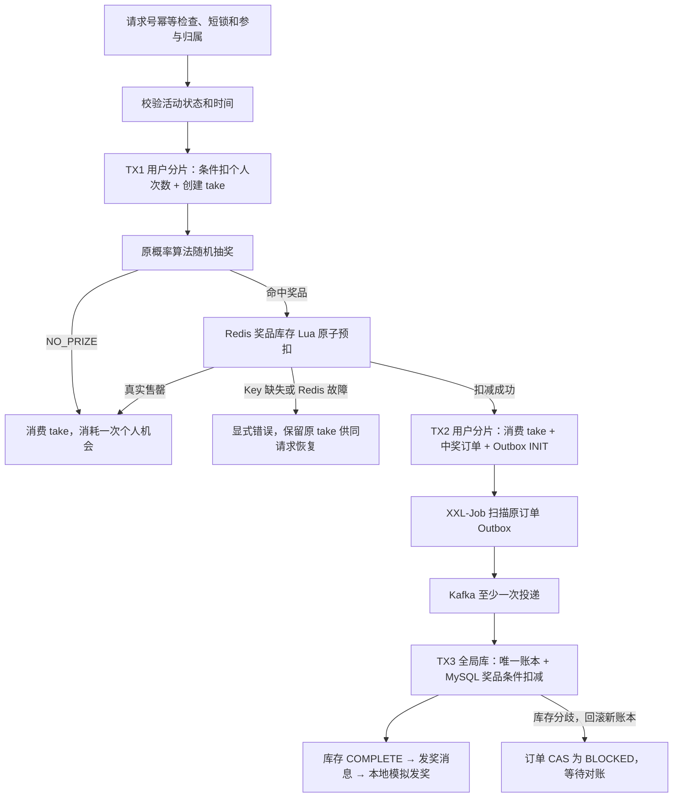

# 取消活动总库存 · 2026-11-02

当前系统只保留两种约束：**用户个人参与次数**和**策略奖品库存**。活动仍独立保存名称、描述、起止时间、状态、`take_count`、`strategy_id` 和创建信息，不再限制整场活动的总抽奖名额。

旧活动 Redis 余量没有完整的 MySQL 持久化结算链路，`activity.stock_surplus_count` 不能作为运行期真实余量。此次取消这项业务限制，同时删除相关实现；没有合并活动与策略，没有改变概率算法或奖品售罄后的概率语义，也没有重设计 Kafka、Outbox、账本或分库分表。

## 主要改动

- `BaseActivityPartake` 删除活动库存预扣和失败回补，校验活动后直接调用用户参与事务；未完成 take 的归属检查、复用和唯一冲突后的回读保留。
- `ActivityPartakeImpl` 只检查活动状态与时间。`UserTakeActivityRepository` 用现有 `TransactionTemplate` 执行 TX1，不再依赖活动仓储或 Redis 库存回补。
- 活动 PO、`ActivityVO`、`ActivityBillVO`、`PartakeResult` 和 Mapper 移除活动库存字段，删除仅用于活动库存的 `StockResult`、Redis Key 工厂、扣减/回补方法及 D004/D005 响应码，不保留含义错误的占位字段。
- 启动只预热策略奖品。`warmupAwardStockForActivity` 明确命名；活动行锁、时间检查、PASS→DOING CAS 保留，增加共享策略行锁和已使用奖池检查，防止第二个活动启动时覆盖或复活库存。
- 基线、压测种子、Java 压测入口、JMeter 断言、库存审计和测试夹具同步更新；活动种子从 PASS 开始，经正常启动预热奖品后运行。
- README、架构、面试叙事、请求幂等和长期规范更新。旧审计、故障报告、压测数据和 2026-11-01 图解保留为明确标注的历史材料，未改写其性能结果或 Archify 产物。

`ActivityProcessImpl`、`DrawExecutor`、`OrderRepository`、`StrategyRepository`、`RedisUtil`、库存/发奖消费者及消息状态 Mapper 的既有奖品链路保留。工作区原有的故障修复、缓存提交后失效和 Snowflake 节点配置改动也保留；开发验证阶段未提交或推送，也未修改相邻仓库；随后按用户追加授权提交相关业务交付。

## 最终流程与事务



| 事务 | 数据库边界 | 保留的不变量 |
| --- | --- | --- |
| TX1 | 用户所属 `lottery_01` / `lottery_02` | `left_count > 0` 条件扣减与参与 INSERT 同成同败；次数不足不创建 take；请求/未完成唯一冲突回滚本次扣减 |
| TX2 | 同一用户分片及既有中奖订单分表 | take 状态 CAS、订单和 `stock_mq_state=INIT` 同事务；下单失败保留奖品回补及真实事务完成状态判定 |
| TX3 | 全局库 `lottery` | `UNIQUE(order_id)` 账本与 `award_surplus_count > 0` 条件扣减同事务；库存不足回滚新账本，重复投递不重复扣库存 |

三个事务独立，不在应用层新增跨 Repository 大事务。未中奖仍消耗已成功取得的个人资格。奖品全部售罄时，用户可以继续取得个人资格并得到未中奖结果；个人次数耗尽后拒绝新的请求。相同请求回放原结果，不能再次耗次；不同请求不能取得他人的未完成 take。

Redis 保存实时奖品可售余量，MySQL 保存持久化结算事实，两者不能互相替代。中奖订单 Outbox 保留已落单后的消息义务，XXL-Job 扫描 INIT/FAIL 和超时 SENT；账本吸收重复消费，CAS 保护 COMPLETE/BLOCKED 不被迟到发送回调覆盖。发奖状态机和补偿条件不变。

## 启动与共享策略

1. 在全局库事务中锁定活动行，确认 PASS 且 `begin <= now < end`。
2. 锁定关联策略行，确认策略存在且配置了奖品与非负剩余库存；不同活动共享一个策略时串行检查奖池。
3. 未投入使用的奖池用 MySQL `award_surplus_count` 执行 SETNX，不覆盖任何现存实时值。新奖池部分预热失败保留成功 Key，活动仍为 PASS，下一次补齐缺失项。
4. 已有 DOING/CLOSE 活动引用该策略时只检查现存奖品 Key，缺失明确报错并保持 PASS，不从可能滞后的 MySQL 回填。关闭后仍可能有在途订单；CLOSE 也不能证明奖池从未使用，若曾在首次启动前关闭引用活动且没有 Redis Key，需要先人工确认和初始化奖池。
5. 奖品库存可用后才 CAS 到 DOING；重复启动不预热，运行期丢 Key 走人工对账。没有活动库存 Key。

真实 E2E 同时验证共享策略已有预扣、MySQL 尚未结算时启动第二个活动：Redis 9 保持 9，两活动分别中奖后为 8，最终两条账本与 MySQL 8 收敛。共享池缺 Key 时，首个活动运行或关闭都不能借另一个活动启动复活库存。

## 数据库初始化与旧库升级

基线 `doc/sql/lottery.sql` 的 activity 建表、四条种子和显式 INSERT 列已同步删除 `stock_count`、`stock_surplus_count`；奖品两列保留。压测 SQL 的活动配置与查询也不再引用旧列。

**全新测试库**：按三个库的基线建表，执行既有所需的库存 Outbox、V2 账本、V3 请求归属及补偿索引迁移。新版 activity 已无两列，**不执行 V4**。基线包含 DROP，只用于新建隔离环境；新种子为 PASS，须经正常生命周期启动，不能直接改成 DOING 跳过奖品预热。

**已有数据库**：在此前所需迁移已经具备的基础上，停止旧版应用与调度任务，人工执行一次 [V4__remove_activity_stock.sql](sql/V4__remove_activity_stock.sql)，再启动新版。执行示例（实际主机、账号由部署环境填写）：

```bash
mysql -h <host> -P <port> -u <user> -p < docs/sql/V4__remove_activity_stock.sql
```

V4 仅对全局库 `lottery.activity` 执行一个 ALTER，删除两个活动库存列；活动行、个人次数、参与、中奖订单和库存账本不删除、不重建、不清空。MySQL DDL 不能用普通事务回滚，新旧应用不混跑。已有 Redis 活动库存 Key 由新版忽略，迁移不会自动删除任何 Redis 数据。活动配置缓存仍必要，重启新版不再读取旧 JSON 中的库存字段。

这是一项明确的数据库和内部 Java 模型不兼容变更，调用方须移除活动库存字段。当前 `/api/v1/draw` 和 `/api/v1/activities` DTO 原本不暴露这些字段，接口的请求归属、中奖返回和用户路由保持原样。V4 已在专用测试实例真实执行，未对业务数据库执行。

## 实际验证

运行 JDK：Amazon Corretto 1.8.0_482；Maven 3.9.14。使用既有 `lottery-mq-e2e` 独立栈：MySQL 13309、Redis 16379、Kafka 19092；SQL 专项使用独立 MySQL 13319。E2E 仅重建专用 fixture，测试中停启专用 Redis/Broker；不连接业务数据库。

从仓库根目录执行，JAVA_HOME 指向上述 Java 8：

```bash
mvn -DskipTests compile
mvn clean package

docker compose -f lottery-interfaces/src/test/resources/mq-e2e/docker-compose.yml up -d --wait
docker start lottery-final-sql-it

mvn test \
  -Dtest=ActivitySchemaMigrationManualIT,MqStateCasManualIT,DrawRequestOwnershipManualIT,FinalBusinessE2eManualIT,MqMiddlewareE2eManualIT,RedisStockFailureManualIT \
  -Dsurefire.failIfNoSpecifiedTests=false \
  -Dlottery.it.mysql=jdbc:mysql://127.0.0.1:13319/ \
  -Dlottery.it.redis.port=16379

# 新库种子调整为 PASS 后，再次定向执行完整种子与 V4 升级检查。
mvn test -Dtest=ActivitySchemaMigrationManualIT \
  -Dsurefire.failIfNoSpecifiedTests=false \
  -Dlottery.it.mysql=jdbc:mysql://127.0.0.1:13319/
```

| 检查 | 通过 | 失败 / 错误 / 跳过 |
| --- | ---: | ---: |
| 默认单元测试与 Java 8 clean package | 48 | 0 / 0 / 0 |
| ActivitySchemaMigrationManualIT：完整四条种子及真实 V4，活动与奖品数据保留 | 1 | 0 / 0 / 0 |
| DrawRequestOwnershipManualIT：真实两库八表、请求归属、次数与唯一冲突、最后一次机会并发 | 10 | 0 / 0 / 0 |
| FinalBusinessE2eManualIT：真实 HTTP、TX1/TX2 回滚、未中奖/售罄、生命周期、共享策略及异步结算 | 22 | 0 / 0 / 0 |
| MqStateCasManualIT：生产 Mapper CAS、迟到回调、并发和超时扫描 | 13 | 0 / 0 / 0 |
| MqMiddlewareE2eManualIT：真实 Kafka 重投、Outbox、账本回滚、Broker 故障恢复和发奖 | 9 | 0 / 0 / 0 |
| RedisStockFailureManualIT：真实 Lua、缺 Key、回补错误与 64 请求争抢有限奖品 | 6 | 0 / 0 / 0 |
| 合计（定向重复运行不重复计数） | **109** | **0 / 0 / 0** |

从实际 Surefire XML 提取的测试名、数量和 Java 版本见 [验证摘要](validation/activity-stock-removal-20261102.json)。首轮 testCompile 发现两个已过时的活动 Key 断言，改为奖品 Key 后重新完整打包通过；没有禁用测试。专用数据导入与迁移、共享策略和消息回归均实际执行。

压测 `PerfHarness.java` / `PerfTiming.java` 另用本轮 WAR 的实际依赖和当前模块类，以 Java 8 javac 编译通过。Python/JMeter 等静态检查与最终 diff 检查结果在下方收尾记录，不把编译或语法通过写成新容量实测。

## 剩余边界

- Redis 奖品预扣后、TX2 落单前 JVM 崩溃，或事务完成结果未知、回补失败，仍可能遗留预留；没有持久预留协议或自动跨存储对账。缺 Key 和 BLOCKED 需要按在途订单、账本及真实库存人工处理。
- 发奖仍为本地模拟，XXL-Job Handler 在 E2E 中由测试直接调用；真实外部渠道、外部 Admin 调度、多实例和 Kafka 高可用未验证。
- 本次未运行新的 JMeter 容量实验，也未把需要业务种子或专用压测数据的全部 legacy ManualIT 批量连到业务环境；已选取并执行覆盖本次主链路的集成套件。历史性能结论不迁移到当前版本。
- 原有 2026-11-01 图解和源码摘录作为历史快照保留，本轮没有重绘；当前语义以本文、README 和 architecture.md 为准。

活动总库存的运行时代码、SQL 依赖和当前工具已移除，系统按个人次数与策略奖品库存运行；本轮真实主链路回归通过，不宣称跨 Redis/MySQL 原子一致性。

## 收尾检查

- Python 7个文件语法、JMeter 3个计划及MyBatis 2个Mapper解析、guide-data.js语法通过；163处本地文档链接存在性检查通过。
- 运行代码及当前活动种子的旧字段、活动库存Key/预扣/回补和旧响应码残留为0；迁移与测试中保留旧名称用于升级及“不存在”断言。历史材料有明确版本声明。
- 对照任务开始的工作区快照，奖品抽奖、TX2/TX3、Lua、MQ、用户次数及关键Mapper等14个文件逐字节未变。本任务新增行空白检查通过。
- 全量 `git diff --check` 仍报告任务开始前已有的08/09图解生成HTML各一处尾随空白；排除这两个原有产物后其余工作区检查通过，本轮不改写历史生成产物。
- 本轮启动的专用测试容器收尾停止，容器及数据卷保留；业务实例与相邻仓库未修改；后续版本交付按用户追加授权提交并推送。

## Git 交付范围

真实链路验证后，用户授权本次及后续已验证业务链路自动提交和推送。此次包含活动总库存重构及验证依赖的既有奖品库存/事务修复、对应测试和主文档。原有 Agent 配置清理和11月1日图解重绘继续留在本地；图解仅提交本次历史版本提示，远端保留其原有历史图解，本地15幅优化版不混入本次业务提交。没有强推或覆盖历史。

相关业务交付及自动提交偏好已提交并推送到GitHub `origin/main`。本次使用同仓库HTTPS通道完成推送，未改变origin配置，也未强推；业务源码、测试、配置和SQL与已验证版本一致。
