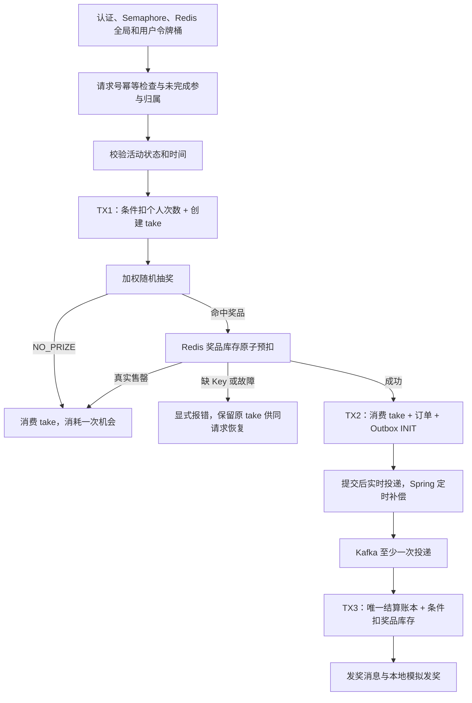

# Architecture Notes

本文记录重构后的架构决策、每个中间件的存在理由与已知约束。抽奖请求级失败语义见 README「Failure Cases」；逐类审计结论见 `docs/refactor-audit.md`。

---

## 1. 架构总览

```text
              HTTP
               │
        LotteryController          (interfaces —— 身份、参数、限流与 DTO)
               │
        ActivityProcessImpl        (application —— use case 编排 / MQ 触发)
     ┌─────┴──────────┐
ActivityPartakeImpl   DrawExecutor ── AwardOrderImpl   (domain —— 业务规则)
               │
       Repository 接口（domain 定义）
               │
  ActivityRepository / DrawConfigRepository / DrawParticipationRepository /
  OrderRepository                       (infrastructure —— MyBatis+Redis+本地事务)
```

分层职责：

* **interfaces**：HTTP adapter。不做业务规则。
* **application**：use case 编排（draw 幂等回放、Kafka 收发、Spring 定时任务）。
* **domain**：参与资格检查、状态机转换矩阵、加权随机抽样、订单创建语义、发奖抽象。
* **infrastructure**：MyBatis、Redis（库存/锁/缓存）、本地事务边界。

MyBatis 与 `TransactionTemplate` 使用同一个 Hikari 数据源，事务在对应仓储内管理。


## 当前业务约束与事务主链路

系统只限制每位用户的参与次数和策略奖品库存。活动保存名称、时间、状态、`take_count` 和 `draw_config_id`，没有全场总抽奖名额。取消活动总库存，是因为该业务限制已不需要，且旧 MySQL 活动余量没有完整结算链路；不合并活动与策略，不改变概率算法。



TX1 不访问 Redis 库存；次数扣减与参与插入一起回滚，唯一键冲突不重复耗次。TX2 失败保留现有奖品回补与事务结果判定，不在应用层扩大事务。TX3 扣减失败回滚新账本，再由独立订单 CAS 写 BLOCKED；已有账本证明同订单已结算。Redis 预扣后、TX2 提交前的 JVM 崩溃和提交结果未知仍需人工对账，Outbox 无法覆盖没有订单的预留。

启动在活动行锁内检查 PASS 和有效时间，再锁共享策略行。新奖池只用 MySQL `award_surplus_count` SETNX，已有 Key 保留实时余量；已被 DOING/CLOSE 活动引用的奖池只检查现存 Key，缺失则拒绝启动，避免关闭后的在途结算或第二个活动把奖品复活。CLOSE 不能证明奖池从未使用，若在首次启动前关闭过唯一引用活动且 Redis 无 Key，也需人工确认奖池后初始化。任何预热异常使活动保持 PASS。

[数据库初始化与 V6 升级](single-database.md) 提供当前表结构及历史数据迁移顺序。

## 2. 组件存在理由（自检清单）

### Redis 为什么存在？
接口令牌桶、策略奖品库存原子预扣、抽奖并发防重入锁、DrawConfigSnapshot L2 和活动配置缓存。
Redis 不承担任何“最终是否处理过”的事实判定：DONE 类 guard 已删除，幂等事实在 MySQL 唯一约束里。

库存检查与条件扣减在单 Key Lua 中完成，售罄不写负数；缺失 Key 明确报错，奖品缺失不会被消费成未中奖。回补只修改现存 Key，异常不吞掉。订单 SQL 异常仅在事务未开始或确认回滚时归还奖品预扣，提交结果未知保留日志待对账，不能凭异常无条件加库存。

### Kafka 为什么存在？
把数据库库存结算与发奖这两个慢操作从同步抽奖路径剥离，同时获得削峰与 at-least-once 重试能力。
消息 key 固定为 orderId，保证同一订单结算事件有序。

### Outbox 为什么存在？
避免 “DB 提交成功 → JVM crash → 消息永远没有发出去”。订单写入与 `stock_settlement_event_status=0`
在同一事务落库，提交后立即尝试发送，Spring 调度按独立重试时间补偿失败、漏发及消费超时订单。
库存条件扣减分歧进入独立 BLOCKED=4 等待对账，发送 FAIL=2 继续自动重试；对账后按订单显式 CAS 4→0 恢复原 Outbox。
发送与消费事件以 SQL 条件更新推进状态，迟到发送回调不能覆盖 COMPLETE；发奖发送成功统一为 SENT，消费确认 award_fulfillment_status 后才收口 COMPLETE。详见[消息状态修复说明](kafka-mq-state-cas.md)。

### settlement ledger 为什么存在？
保证 Kafka duplicate delivery / consumer crash 后的重复消费不会让同一个 orderId 扣两次库存。
`INSERT award_stock_settlement(UNIQUE order_id) + UPDATE draw_config_prize ... surplus>0`
是同一个本地事务，账本唯一键冲突表示已结算。

### Spring 定时调度

三个固定延迟任务独立执行活动状态推进、库存重试与发奖重试。订单提交后的发送由有界 Outbox 工作池完成。重试规则、V7 部署及 BLOCKED 对账见 [订单 Outbox](outbox-delivery.md)。

### Caffeine 为什么存在？
DrawConfigSnapshot 是每次抽奖必需、活动运行期基本不变的热点读：
Caffeine L1(60s, max 10000) + Redis L2(600s+jitter120s)。
一致性边界明确为**短 TTL 最终一致**：运营变更后 TTL 内可能读到旧版本，不做广播失效。
其余实体不再有 L1（activity 只留 Redis 单级；award 信息并入快照；ruleTree 已删除）。
配置事务的缓存失效延迟到 afterCommit，回滚不删除；其它实例 L1 与在途加载仍遵循上述最终一致边界。

### MySQL 数据如何组织？
`draw_participation`、`user_activity_quota`、`draw_order` 各自使用单表。参与次数表 `UNIQUE(u_id,activity_id)` 保证同一用户在同一活动的次数语义。

## 3. 抽奖概率模型

* 快照构建：BigDecimal `award_rate × 1,000,000` 取整为整数权重；总和 >100% 直接抛异常 fail fast。
* 总和不足 100% 的差额整体划入 `NO_PRIZE`（采样数组尾部一个 null 槽位），保证剩余概率不会重新分配给真实奖品。
* 采样：`ThreadLocalRandom.nextLong(totalWeight)+1`，对前缀和数组二分（奖品种类少，不引入 Alias Method 的复杂度）。
* 运行期命中已售罄奖品 → 本次视为未中奖并告警日志；**不做重新归一化**，其他奖品概率保持配置值不变。

## 4. 状态机

```text
EDIT(1) ──确认就绪──▶ PASS(4) ──调度到期──▶ DOING(5) ──过期/关闭──▶ CLOSE(7)
                          │
                          └──人工下线──▶ CLOSE(7)
```

落地即一条 CAS：`UPDATE activity SET state=:target WHERE activity_id=:id AND state=:expected`，
影响行数为 0 表示并发冲突或非法前置状态。历史 DB 中的提审/撤审/拒绝/开启态没有生产语义，
migration 注释提供归并语句（默认不自动执行 DROP/UPDATE）。

## 5. 测试体系

| 层级 | 内容 | 环境 |
| --- | --- | --- |
| 单元测试（CI 门禁） | WeightedRandomSelectorTest（微精度概率、NO_PRIZE、越界拒绝、边界采样）；RedisActivityDrawProcessGuardTest（锁 token/Lua 释放）；DrawRequestIdempotencyTest（编排层幂等：全流程一次/回放已消费 take/复用未完成 take/异常时释放锁） | 无需外部环境 |
| 手工集成测试（ManualIT） | StockSettlementIdempotencyManualIT（场景 B 并发预扣不超卖、C/D 同一 orderId 二次结算被 UNIQUE 拦截）；DrawExecManualIT 等 legacy 场景 | 本机 MySQL+Redis，`mvn test -Dtest='*ManualIT'` |

运行要求：MySQL（lottery，端口 13306）、Redis localhost:6379、可选 Kafka localhost:9092；
新库执行完整 Schema，历史库先核对 V5 前置结构再执行 V6。详见 [部署说明](single-database.md)。

## 6. 部署与请求归属

[单库部署](single-database.md) 记录历史分片数据合并与切换步骤。[抽奖幂等接口](draw-request-idempotency.md) 记录请求归属和未完成请求恢复。

最终一轮的活动创建、分页、预热恢复、库存分歧及真实 HTTP 主链路证据见[最终正确性与 E2E 报告](final-correctness-e2e.md)。

后续库存异常、事务回补、缓存提交时序及显式 Snowflake 节点配置修复，见[2026-10-24 故障评估](failure-review-20261024.md)。
