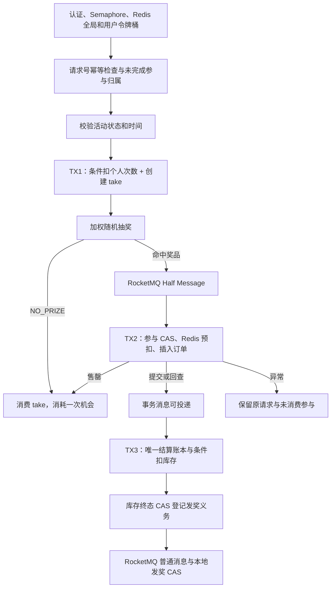

# Architecture Notes

本文记录重构后的架构决策、每个中间件的存在理由与已知约束。抽奖请求级失败语义见 README「Failure Cases」；逐类审计结论见 `docs/refactor-audit.md`。

---

## 1. 架构总览

```text
              HTTP
               │
        LotteryController          (interfaces —— 身份、参数、限流与 DTO)
               │
        ActivityProcessImpl        (application —— use case 编排 / MQ 触发)
     ┌─────┴──────────┐
ActivityPartakeImpl   DrawExecutor ── AwardOrderImpl   (domain —— 业务规则)
               │
       Repository 接口（domain 定义）
               │
  ActivityRepository / ActivityPrizeRepository / DrawParticipationRepository /
  OrderRepository                       (infrastructure —— MyBatis+Redis+本地事务)
```

分层职责：

* **interfaces**：HTTP adapter。不做业务规则。
* **application**：use case 编排（draw 幂等回放、RocketMQ 收发、Spring 定时任务）。
* **domain**：参与资格检查、状态机转换矩阵、加权随机抽样、订单创建语义、发奖抽象。
* **infrastructure**：MyBatis、Redis（库存/锁/缓存）、本地事务边界。

MyBatis 与 `TransactionTemplate` 使用同一个 Hikari 数据源，事务在对应仓储内管理。


## 当前业务约束与事务主链路

系统只限制每位用户的参与次数与当前活动的奖品库存。活动保存名称、时间、状态和个人次数；独立奖池通过 activity_id 关联活动。同一目录奖品可用于多个活动，概率和库存各自独立。见[七表模型与 V8 切换](activity-prize-pool.md)。



TX1 原子扣次并创建参与。TX2 的 Redis Lua 同时登记预扣，崩溃后使用参与行锁和已提交订单回收或清除。Broker 回查同样以订单、截止时间和参与行锁判定事务状态。TX3 结算失败回滚新账本，再由订单 CAS 写 BLOCKED。已存在的唯一账本证明同订单已结算。

启动在活动行锁内检查 READY 和活动时间，以 SETNX 建立奖品库存后 CAS 为 RUNNING。重复预热保留已有余额；RUNNING 和 CLOSED 的缺键必须对账。预热失败仍为 READY。

[数据库初始化与 V8 升级](activity-prize-pool.md) 提供当前表结构及历史数据迁移顺序。

## 2. 组件存在理由（自检清单）

### Redis 为什么存在？
接口令牌桶、活动奖品库存原子预扣、抽奖并发防重入锁、ActivityPrizeSnapshot L2 和活动配置缓存。
Redis 不承担任何“最终是否处理过”的事实判定：DONE 类 guard 已删除，幂等事实在 MySQL 唯一约束里。

库存 Lua 原子检查余量、登记预扣并扣减。回补须在持有参与锁且不存在对应订单时执行，归还后删除标记。库存 Key 缺失显式报错并保留原参与，恢复余额需要对账。

### RocketMQ 与订单对账

库存事务消息连接 TX2 提交与库存首发。发奖走普通消息，库存完成 CAS 持久登记发奖义务。定时扫描承担发奖首发失败与库存超过回查或重投窗口后的恢复。领取只更新下次核对时间，业务终态通过消费者 CAS 推进。 [事务协议与验证](rocketmq-transactional-report.md)

### 库存账本

结算账本 INSERT 与库存条件 UPDATE 在 TX3 一起提交，重复消息通过唯一订单号去重。

### Caffeine 为什么存在？
ActivityPrizeSnapshot 是每次抽奖必需、活动运行期基本不变的热点读：
Caffeine L1(60s, max 10000) + Redis L2(600s+jitter120s)。
一致性边界明确为**短 TTL 最终一致**：运营变更后 TTL 内可能读到旧版本，不做广播失效。
其余实体不再有 L1（activity 只留 Redis 单级；award 信息并入快照；ruleTree 已删除）。
配置事务的缓存失效延迟到 afterCommit，回滚不删除；其它实例 L1 与在途加载仍遵循上述最终一致边界。

### MySQL 数据如何组织？
`draw_participation`、`user_activity_quota`、`draw_order` 各自使用单表。参与次数表 `UNIQUE(u_id,activity_id)` 保证同一用户在同一活动的次数语义。

## 3. 抽奖概率模型

* 快照构建：BigDecimal `award_rate × 1,000,000` 取整为整数权重；总和 >100% 直接抛异常 fail fast。
* 总和不足 100% 的差额整体划入 `NO_PRIZE`（采样数组尾部一个 null 槽位），保证剩余概率不会重新分配给真实奖品。
* 采样：`ThreadLocalRandom.nextLong(totalWeight)+1`，对前缀和数组二分（奖品种类少，不引入 Alias Method 的复杂度）。
* 运行期命中已售罄奖品 → 本次视为未中奖并告警日志；**不做重新归一化**，其他奖品概率保持配置值不变。

## 4. 状态机

```text
DRAFT(1) ──确认就绪──▶ READY(4) ──到开始时间──▶ RUNNING(5) ──到期/关闭──▶ CLOSED(7)
                          │
                          └──人工下线──▶ CLOSED(7)
```

落地即一条 CAS：`UPDATE activity SET state=:target WHERE activity_id=:id AND state=:expected`，
影响行数为 0 表示并发冲突或非法前置状态。V8 保留原数值 1/4/5/7，遇到其他历史状态时中止迁移，由业务确认归属。

## 5. 测试体系

| 层级 | 内容 | 环境 |
| --- | --- | --- |
| 单元测试（CI 门禁） | WeightedRandomSelectorTest（微精度概率、NO_PRIZE、越界拒绝、边界采样）；RedisActivityDrawProcessGuardTest（锁 token/Lua 释放）；DrawRequestIdempotencyTest（编排层幂等：全流程一次/回放已消费 take/复用未完成 take/异常时释放锁） | 无需外部环境 |
| 真实中间件回归 | FinalBusinessE2eManualIT、RedisStockFailureManualIT 与 SQL 专项覆盖并发、库存、订单和故障恢复 | 专用 MySQL、Redis、RocketMQ；见 [回归复现](rocketmq-transactional-report.md) |

运行使用 MySQL 8.0、Redis 和 RocketMQ。RocketMQ 分支从当前完整 Schema 建新库。

## 6. 部署与请求归属

[单库部署](single-database.md) 记录历史分片数据合并与切换步骤。[抽奖幂等接口](draw-request-idempotency.md) 记录请求归属和未完成请求恢复。

当前活动创建、预热、迁移回放和真实 HTTP 主链路证据见 [V8 实测](activity-prize-pool.md#2026-11-13-实测)。

后续库存异常、事务回补、缓存提交时序及显式 Snowflake 节点配置修复，见[2026-10-24 故障评估](failure-review-20261024.md)。
